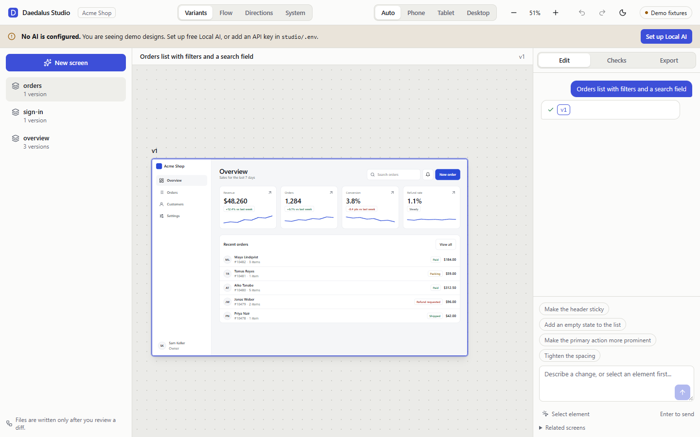

# Local AI: Daedalus without a subscription

You do not need a cloud AI account to use Daedalus Studio. With a reasonably capable PC you can run the model on your
own computer through [Lemonade](https://lemonade-server.ai/), a free, open-source local AI server. Nothing you type,
and none of your `DESIGN.md` or code, leaves your machine.



## Honest expectations

- **Local models are slower and weaker than frontier cloud models.** The small ones that fit an ordinary PC follow a
  design system less reliably, make plainer layouts, and miss details a cloud model catches. Expect a screen to take
  minutes, not seconds, on a processor; a good GPU is much faster.
- **They are good enough to start, explore variants and make small edits, and they are free and private.** For a
  final, polished screen, a cloud model (or a big local model on a strong GPU) is better.
- **How to judge a result:** open the **Checks** tab (tokens only, contrast, 44 px targets, list states, no
  placeholder copy). A local model that passes the checks and looks right to you is fine. If it keeps failing the same
  rule, switch to a larger model, ask for fewer variants, or make the edit by chat in smaller steps. The studio
  re-asks a local model up to twice when it returns malformed JSON, and tells you when it gives up.

## Requirements

Measured peak memory of the model process while generating with a 32k-token context. The numbers come from the
maintainer's measurements on a Ryzen 9 CPU and a 16 GB Radeon RX 9060 XT; yours will differ a little.

| Your machine | Model the studio recommends | Download | Memory while running | Licence |
|---|---|---|---|---|
| 8 to 15 GB RAM | Qwen3.5 4B (Q4_K_M) | 3.0 GB | about 6.4 GB | Apache-2.0 |
| 16 GB RAM or more, or a GPU with 8 GB or more | MiMo V2.6 9B (Q4_K_M; compact IQ4_XS when memory is tight) | 5.8 GB (compact 5.2 GB) | about 10 GB (compact 9.4 GB); on a GPU 6.6 to 6.9 GB of graphics memory | MIT |
| 16 GB graphics card (optional "best quality") | Qwen3.8 27B (UD-IQ3_S, community conversion by Unsloth) | 12.0 GB | about 13.6 GB (estimate, not measured) | Apache-2.0 |

Only models under Apache-2.0 or MIT are recommended. Licences were read from each model card on Hugging Face on
2026-11-17 (Qwen3.5-4B and Qwen3.8-27B: Apache-2.0; MiMo-V2.6-Distill-Qwen-9B: MIT; the GGUF files are
conversions of those models).

**Minimum supported:** 8 GB RAM, 15 GB free disk, a 64-bit CPU with AVX2 (nearly every x86 processor since 2015; any
Apple Silicon or 64-bit ARM). The 4B model fits, slowly; close other programs while it runs.

**Recommended:** 32 GB RAM, or a GPU with 12 to 16 GB of graphics memory, or Apple Silicon with 16 GB or more
(unified memory; Lemonade uses Metal). An SSD matters: models are 3 to 12 GB and load from disk.

| Hardware | What to expect |
|---|---|
| CPU only, 8 GB | 4B model, usable for small edits; slow for whole pages |
| CPU only, 16 to 32 GB | 9B model, noticeably better designs; a page takes minutes |
| GPU 8 GB or more (AMD, NVIDIA) | 9B model fully on the GPU: several times faster than the CPU |
| GPU 16 GB | the 9B model comfortably; the optional 27B model fits at low-bit quantisation |
| Apple Silicon 16 GB or more | 9B model on the GPU through Metal |
| Ryzen AI (NPU) | Lemonade can run some models on the NPU (its `flm` and ONNX backends). The studio does not require it; use the GPU or CPU models above unless you know the NPU model you want. |

Lemonade runs on Windows 11, Linux and macOS and supports Vulkan, ROCm, CUDA, Metal and CPU backends through
llama.cpp. On the maintainer's RX 9060 XT, the ROCm build ran the 9B model about eight times faster than the
Vulkan build (74 against 8.5 tokens per second): if generation is unexpectedly slow, try another backend in Lemonade.

## Check your computer

```sh
daedalus doctor            # from a generated project
deno task doctor           # from the checkout: deno task --cwd studio doctor
```

It prints RAM, free disk, GPU memory (read from the registry, `/sys`, `nvidia-smi` or `sysctl`, whatever your OS
exposes), AVX2 where it can be read, whether Lemonade is running at `LEMONADE_BASE_URL`, and the tier and model it
recommends. It changes nothing. `--json` prints the same as data, `--no-probe` skips the Lemonade check. It exits with
1 when the machine is below the minimum.

## Set it up

1. **Install Lemonade** from https://lemonade-server.ai/ (installers for Windows, Linux, macOS, plus Docker) and
   start it. The tray app starts the server; `lemond` runs it from a terminal. It listens on
   `http://localhost:13305/api/v1` by default and speaks the OpenAI, Anthropic and Ollama APIs.
2. **Start the studio** (`deno task studio`). With no API key configured, it opens with a banner "No AI is configured"
   and shows demo designs, so you can look around at once.
3. **Click "Set up Local AI"** (or the model chip in the top bar). The panel shows your hardware, the recommended
   model and Lemonade's state. **Download and load** registers the model from Hugging Face, downloads it (progress bar,
   cancel keeps the partial file), loads it with a 32k context and asks it a test sum before the studio trusts it.
4. The studio switches to it. Generate a screen.

The studio never downloads anything until you press the button, and it only talks to the server you configured.

### Automatic choice

With `STUDIO_PROVIDER=auto` (the default) the studio picks, in order: your Anthropic key if one is set, Lemonade if a
chat model is loaded, Ollama if its model is pulled, and otherwise the demo fixtures with the banner. You can pin any
available one in the model panel. Ollama stays a supported second local option (`OLLAMA_HOST`, `OLLAMA_MODEL`).

### Configuration (`studio/.env`)

| Variable | Meaning |
|---|---|
| `LEMONADE_BASE_URL` | Default `http://localhost:13305/api/v1`. Use another port or another machine (see privacy below). |
| `LEMONADE_API_KEY` | Only if you started Lemonade with an API key. |
| `LEMONADE_MODEL` | Pin a model name; empty means "whatever is loaded". |
| `STUDIO_PROVIDER` | `auto`, `lemonade`, `ollama`, `anthropic` or `fake`. |

### How the studio talks to it

Generation uses Lemonade's OpenAI-compatible `POST /chat/completions`, streamed, so the artboard builds while the model
writes. Structured output is requested as a JSON Schema `response_format`. If a server rejects that, the studio switches
to a strict "return only this JSON" prompt for the rest of the session. Either way the answer is validated against the
tool's schema, and an invalid one is sent back with the exact problems, at most twice.

### A speed tip (optional, measured)

llama.cpp can guess upcoming tokens from text already in the context (n-gram speculation). Start Lemonade with
`LLAMA_ARG_SPEC_TYPE=ngram-simple` in its environment. On the maintainer's GPU a code edit went from 42 to about 230
tokens per second with identical output; plain writing did not change. Design edits repeat a lot of the page, so they
benefit. It needs a llama.cpp build that supports the option; remove it if the server refuses to start.

## Other tools on the same local server

Anything that lets you set an OpenAI-compatible base URL can use `http://localhost:13305/api/v1`, so one download
serves several tools. Lemonade documents these integrations (see its `docs/integrations`): Continue (it has a built-in
"Lemonade Server" provider), Claude Code (`lemonade launch claude`, through Lemonade's Anthropic-compatible API),
OpenHands (start Lemonade with `lemonade config set host=0.0.0.0 ctx_size=32768` so its containers can reach it),
Open WebUI, AnythingLLM and LangChain. For tools Lemonade does not document, check that the tool accepts a custom
OpenAI base URL before relying on it.

Be realistic about coding agents: Lemonade's own Continue guide recommends a code-tuned model of at least 20B
parameters and 16 GB of graphics memory or 64 GB of RAM. The 4B and 9B models in the table above are fine for design
work in the studio but are weak at multi-step code editing.

## Privacy and responsibility

- **Privacy upside.** With a loopback address (`localhost`, `127.0.0.1`) prompts, `DESIGN.md`, tokens and generated
  code stay on your computer, and the studio sends no telemetry. The only internet use is the one-time model download
  from Hugging Face (and Lemonade's own backend downloads), which you start.
- **A remote server is not private.** If `LEMONADE_BASE_URL` points at another machine, your prompts go there; the
  model panel says so. Do not expose Lemonade to your network without an API key.
- **The rules still apply.** A model that runs locally still makes mistakes. Read the diff before you write files, run
  `deno task check`, never paste secrets or personal data into a brief, and keep the licences of the generated
  code and of any model weights you add in mind. The studio only recommends Apache-2.0 and MIT models; if you pick
  another model yourself, read its licence.

## Troubleshooting

| Symptom | What to do |
|---|---|
| "Lemonade is not running" in the panel | Start the Lemonade tray app or `lemond`; check `LEMONADE_BASE_URL` and the port. |
| "Not enough free disk space" | Free 15 GB or more; the model and runtime need it. |
| The model loads but "answered ... to a simple sum" | The GPU backend may be broken for that model. Try the compact model, another backend in Lemonade, or the CPU backend. |
| "could not produce a valid answer after 3 tries" | The model is too small for that request. Ask for 1 variant, a smaller screen, or use a bigger model. |
| Very slow generation | Close other programs, check which backend Lemonade chose (a GPU backend is much faster), try the speed tip above. |
