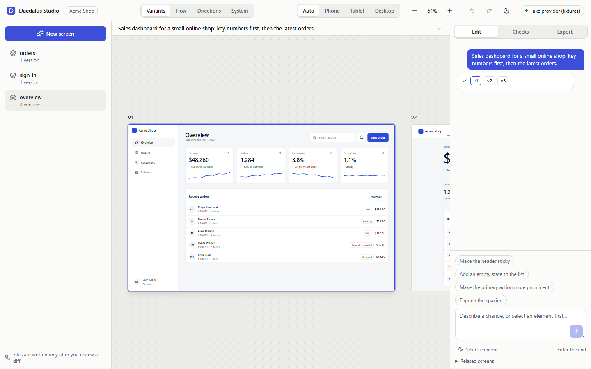
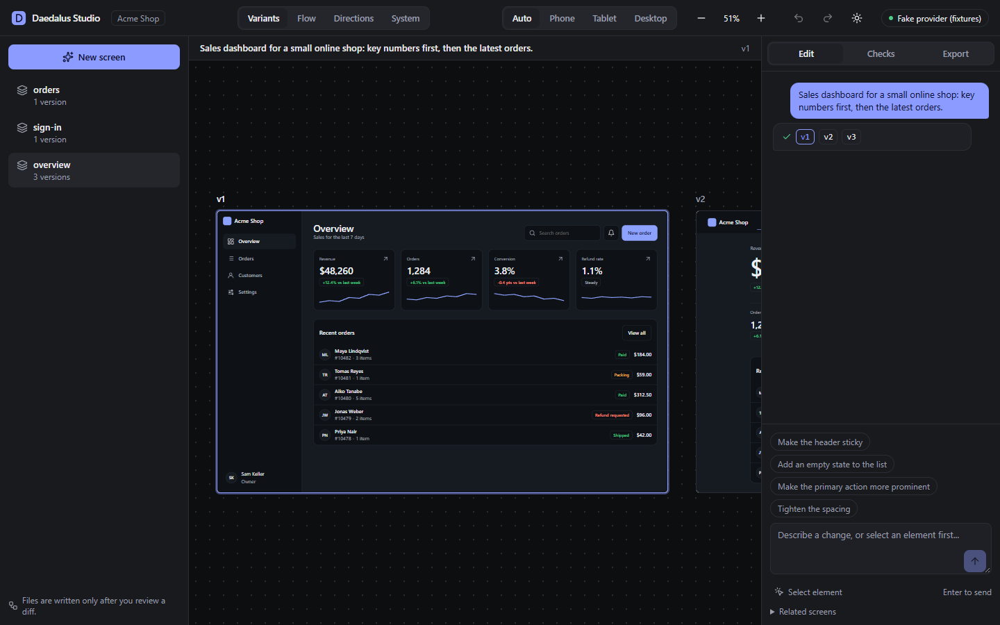
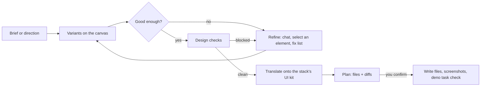
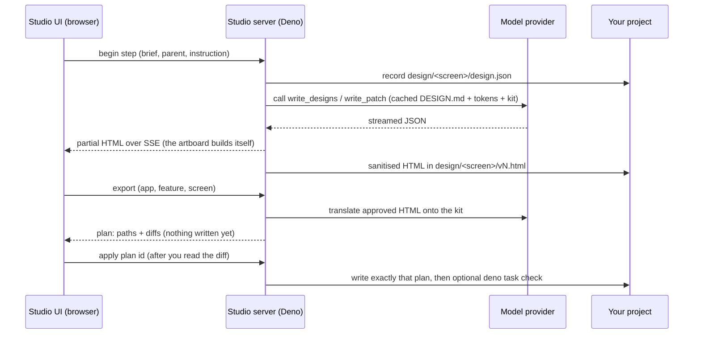
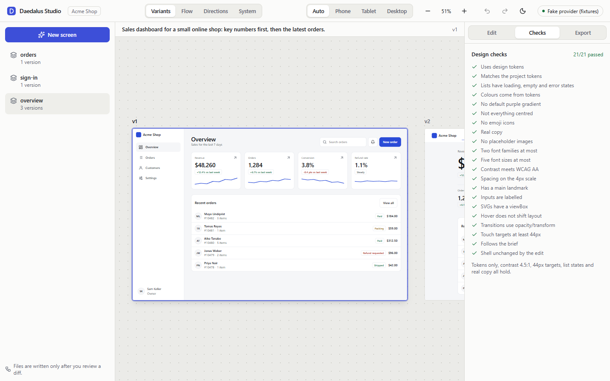
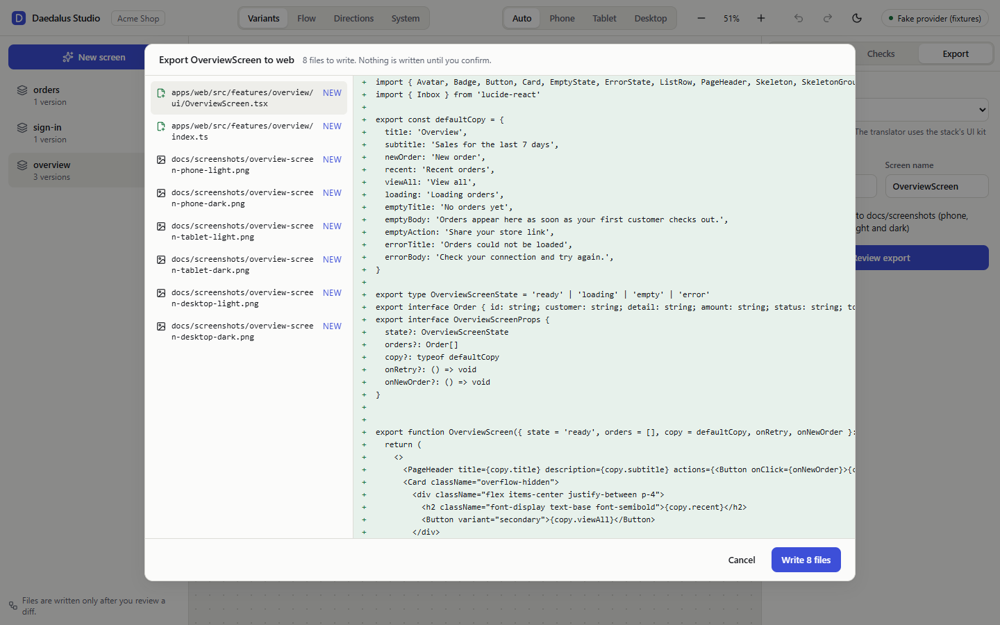
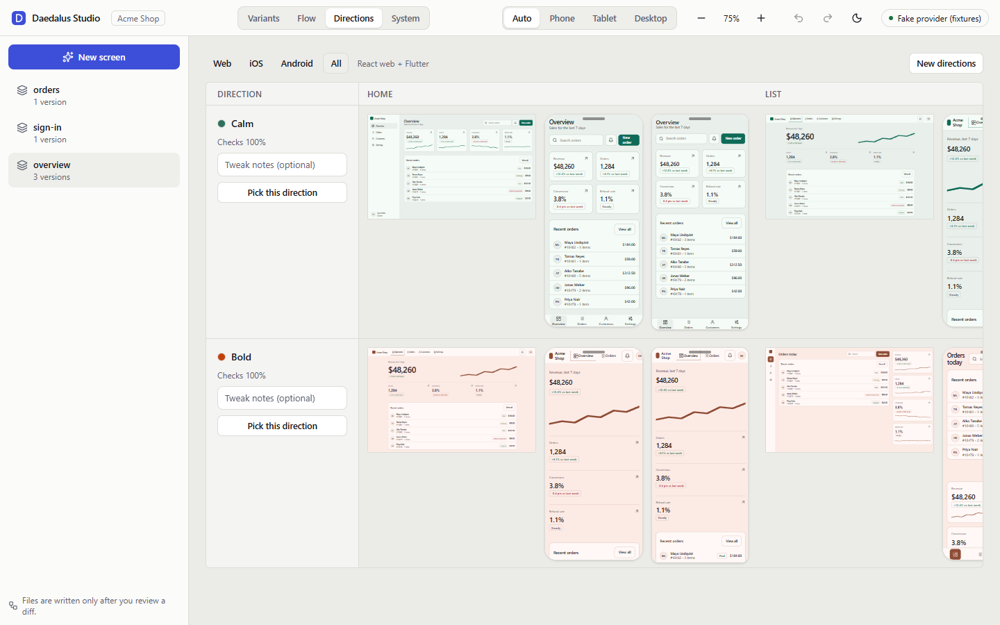
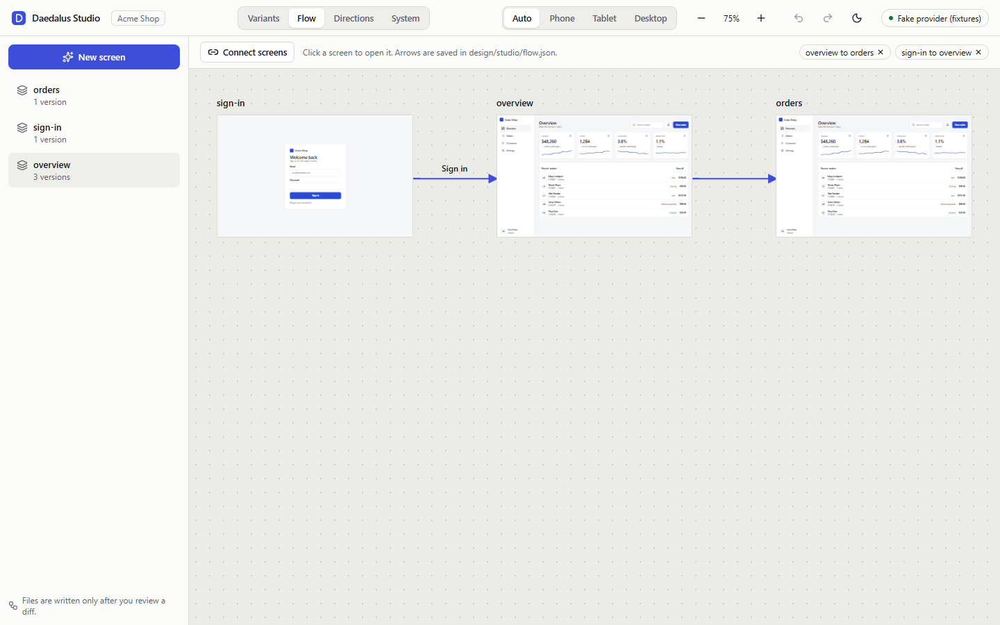
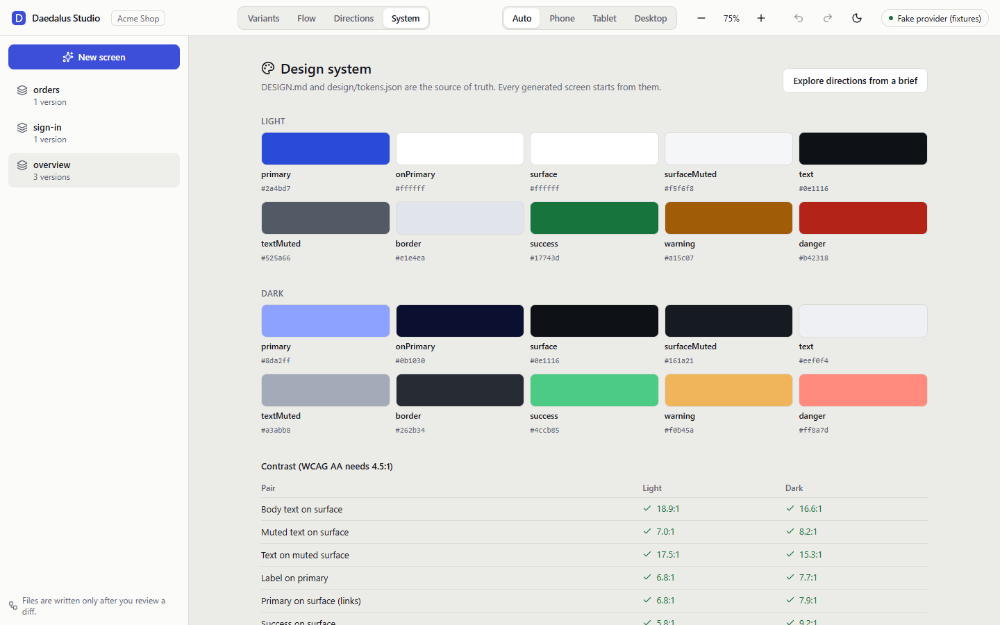

# Daedalus Studio

A local design studio for a Daedalus project: describe a screen or a whole flow in plain words, get several
different versions built from your `DESIGN.md` and `design/tokens.json`, refine them by chat or by selecting an
element, check them against the same rules the exporter enforces, then export the approved screen into the right
stack and feature folder (React, React Native or Flutter) with a diff review first.

It runs on your machine, talks to the model with your own key, and writes nothing to your project until you have
read a diff.





## Run it

From a generated project:

```sh
deno task studio                # builds the UI on the first run, then serves http://127.0.0.1:4310
```

From the Daedalus checkout, without a project, it works on a throwaway demo project in `studio/.demo-project/`:

```sh
cd studio
cp .env.example .env            # then add your key, or choose ollama / fake (below)
deno task start
```

`deno task start --project <dir>` points it at any generated project. `deno task build` rebuilds the UI,
`deno task dev` runs the UI with hot reload against a running server.

## Choose a model

Everything the studio generates goes through one narrow call: "call this tool with JSON". Pick the provider in
`studio/.env` (never committed; `.env.example` documents every key).

| `STUDIO_PROVIDER` | What it is | Notes |
|---|---|---|
| `auto` (default) | Your Anthropic key, then Lemonade, then Ollama, then the demo fixtures | With nothing configured the studio still opens, shows demo designs and a "No AI is configured" banner with a one-click Local AI set-up. |
| `anthropic` | The official `@anthropic-ai/sdk`, model `claude-opus-5-5`, adaptive thinking, streaming, tool use for structured output, prompt caching on `DESIGN.md`, tokens and kit docs | Bring your own key. Forced `tool_choice` is not used (not accepted on this model family); the prompt names the tool. |
| `lemonade` | Local AI through [Lemonade](https://lemonade-server.ai/) (Apache-2.0): OpenAI-compatible streaming chat at `LEMONADE_BASE_URL` (default `http://localhost:13305/api/v1`), JSON-schema structured output with a validated, retried strict-JSON fallback | Free, private, no subscription. The model panel detects it, checks your hardware, and downloads and loads the recommended model on request. Slower and weaker than a cloud model: see [LOCAL-AI.md](LOCAL-AI.md). |
| `ollama` | A local model through Ollama's native `/api/chat`, the tool schema as `format` | Free and offline. The UI labels it "local": small models are weak at layout and at following the token rules. |
| `fake` | Deterministic fixtures | Used by the tests and for demos. No network, no key. |

`deno task doctor` (`daedalus doctor`) checks whether your computer can run local AI and recommends a model tier.

Optional second engine: set `STITCH_API_KEY` and "Google Stitch" appears in the brief form (`@google/stitch-sdk`,
Apache-2.0). Its output goes through the same sanitiser as everything else.

The studio never reads your key from the browser, never logs it and never sends telemetry.

## The flow





## What you can do

| Area | Where |
|---|---|
| Start from a brief, 1 to 5 versions per screen, optional reference image | New screen |
| 3 to 5 visual directions at once, each with its own `DESIGN.md` from a seed colour, the same key screens on web, iOS and Android, a checks score per direction; lock one and apply it to `DESIGN.md` and `design/tokens.json` | Directions |
| Tokens, light and dark swatches, WCAG contrast of every text/background pair, visual presets from `design/presets/`, seed-colour generator | System |
| Edit by chat ("make the header sticky", "add an empty state"), with a conversation view of every version | Edit tab |
| Edit by selecting an element on the artboard, then describing the change | Select element |
| Every edit is a new version (`v1` -> `v1-r1` -> `v1-r2`), so undo and redo walk the version chain (Ctrl+Z, Ctrl+Shift+Z) and the history is plain files in `design/` | Toolbar |
| Phone, tablet and desktop frame sizes, light and dark, zoom | Toolbar |
| All screens on one board with flow arrows saved in `design/studio/flow.json` | Flow |
| Design lint, inline | Checks tab |
| Export into the stack, screenshots, run the project check | Export tab |











## Design checks

The same rules run in the browser (inline) and on the server (before export). Blocking rules stop an export;
placeholder copy can never be forced through.

| Rule | What it checks | Blocks export |
|---|---|---|
| `no-tokens`, `token-drift` | The page carries the project's token block and does not redefine a colour | yes |
| `off-token-colors` | No hard-coded colours outside `:root` | yes |
| `contrast` | Text and background pairs at 4.5:1 or better | yes |
| `touch-targets` | Controls at least 44px (48px on phones) | yes |
| `list-states` | Every list has `data-state` variants for loading, empty and error | yes |
| `lorem-ipsum` | No placeholder copy | yes, never forceable |
| `spacing-scale`, `type-scale`, `font-families` | 4px grid, at most five sizes and two families | warning |
| `landmarks`, `unlabelled-inputs`, `svg-viewbox`, `hover-layout`, `transitions` | Accessibility and layout hygiene | warning |
| `emoji-icons`, `purple-gradient`, `centered-everything`, `placeholder-images` | The generic AI look | warning |
| `brief-constraint`, `shell-drift` | "No sidebar" is respected; an edit does not drop the header or nav | warning |

After translation the generated source is checked too: no hard-coded colours or arbitrary pixel values, no text
literals outside the `copy` prop, no TODO, loading/empty/error states present. A failing translation is sent back
to the model once with the exact findings.

## Export

The approved HTML design is translated by the model onto the stack's own UI kit (using the kit's real exports
as context): `@app/ui` (shadcn/ui based) for web, React Native Reusables with NativeWind for React Native, Forui for
Flutter. All text moves into an exported `defaultCopy` object (or a `Copy` class in Dart) passed as a `copy` prop, so
the screen is localisable; the screen takes a `state` prop (`ready`, `loading`, `empty`, `error`).

| Stack in `.blueprint.json` | Screen file | Also written |
|---|---|---|
| `web-spa`, `web-site` | `<app>/src/features/<feature>/ui/<Screen>.tsx` | `<app>/src/features/<feature>/index.ts` barrel export |
| `mobile-rn` | `<app>/src/features/<feature>/ui/<Screen>.tsx` | barrel export |
| `mobile-flutter` | `<app>/lib/features/<feature>/ui/<snake_case>.dart` | |

Optionally also `docs/screenshots/<screen>-<phone|tablet|desktop>-<light|dark>.png` (needs Chrome or Edge, see
`STUDIO_BROWSER`). "Run deno task check" runs the project's own check and shows its output.

## Safety model

- **Generated code never runs on the host.** Designs are static HTML+CSS. They render only in sandboxed iframes
  (no `allow-same-origin`, CSP `default-src 'none'`, no network); the one script that runs is the studio's own
  selection helper, allowed by a per-frame nonce. A design that contains a script, an event handler, a
  `javascript:` URL, a remote asset or an iframe is sanitised on write and flagged.
- **Writes only inside the project, only after a diff.** The model never writes files. It returns text; the server
  builds a *plan* (paths and contents), shows the diff, and `apply` writes exactly that plan. Every path passes one
  guard: relative, no `..`, no `.git`, `node_modules` or `.env*`, an allow-listed extension, and only the folders
  `design/`, `docs/screenshots/`, `DESIGN.md` and each app's `src/features/` or `lib/features/`. Writes refuse
  symlinks. The single exception is `design/studio/flow.json` (arrow layout, not code).
- **Local only.** The server binds to `127.0.0.1`, rejects a foreign `Host` (DNS rebinding) and a foreign `Origin` on
  posts. Provider keys stay in the server process.
- **User text is data.** Briefs, instructions, `DESIGN.md` and the current design are fenced with a random per-prompt
  token the text cannot close, and the prompt says they are not instructions.
- **No telemetry.** The studio makes no request except to the provider you configured.

## What the studio writes in your project

```
design/
  tokens.json, presets/        read (and written by "Use this preset" / "Apply direction", after a diff)
  <screen>/design.json         brief, target, the steps (every refine is a step)
  <screen>/v1.html, v1-r1.html the versions (sanitised HTML)
  <screen>/*.patch.json        surgical edits, kept for the record
  directions/                  the direction set, shared route map, one DESIGN.md and pages per direction
  selected.json                the locked direction
  studio/flow.json             flow arrows
```

All of it is small, sorted JSON or plain HTML, so it diffs well in git.

## Layout of the code

```
studio/
  server/   providers/ (anthropic, ollama, fake + fixtures), prompts.ts, jobs.ts (generate, refine, directions),
            export.ts (paths, guard, diff, plan/apply), exportFlow.ts, codeLint.ts, screenshots.ts, api.ts, main.ts,
            design/ (store, sanitiser, patching, shells, directions, Stitch, trust and verdict caches)
  shared/   design/ (types, the HTML allowlist policy, lint, contrast, DESIGN.md parser/generator, tokens)
  ui/       src/ (Studio.tsx shell; design/ canvas, edit, checks, export, flow, system, directions)
```

## Tests

`deno task test` in `studio/` (about 130 tests, no network, no AI calls): prompt building and fencing, every lint rule,
export path mapping, the write guard (traversal, protected paths, symlinks), diff and plan/apply, the sanitiser and
its security cases, job orchestration with the fake provider (streaming, surgical edit, escalation to a full rewrite,
failure isolation), the HTTP surface (host/origin guard, end-to-end brief to written files), provider request
shapes (Anthropic with an injected client, Ollama with a fake `fetch`, Lemonade against a fake Lemonade HTTP server on a random port: detection, download and load with progress, streaming, JSON-schema fallback and retries, auto provider order, hardware tiers) and component tests for the UI.

## Prior art

Reviewed for ideas; licences read from each repository on 2026-11-17.

| Project | Licence | Decision |
|---|---|---|
| OpenUI (wandb) | Apache-2.0 | Ideas only (prompt-to-component loop, live preview). |
| Onlook | Apache-2.0 | Ideas only (select an element on the canvas, edit in place). |
| Excalidraw | MIT | Not needed: an infinite canvas of iframes is a small pan/zoom container. |
| react-live, Sandpack | MIT, Apache-2.0 | Not needed: designs are static HTML in sandboxed iframes, not live React. |
| tldraw | custom "tldraw license" (not an OSI licence) | Not used. |
| Google Stitch SDK | Apache-2.0 | Optional engine, bring your own key. |
| Material Color Utilities | Apache-2.0 | Seed colour to a full light/dark scheme for generated `DESIGN.md`. |

The studio's design model (variants, surgical patches, the sanitiser and its trust and verdict caches, directions,
the lint and the progressive renderer) is adapted from the maintainer's earlier design tool and ported to a Deno
server with HTTP and SSE endpoints. See `THIRD_PARTY_NOTICES.md` for dependencies.

## Limits

- Previews are static HTML. The exported React, React Native or Flutter code is a model translation of that
  HTML onto the kit, checked by the code lint and by your project's `deno task check`, but it is not a pixel-exact
  compile of the preview. Review the diff and run the app.
- The Anthropic, Ollama and Stitch paths are covered by request-shape tests only; Lemonade is tested against a fake
  server. None of them was run against a live service in the repository's test run (no key was used, no model was
  downloaded), so real local-model design quality is unmeasured here.
- Screenshots need an installed Chrome or Edge (or `STUDIO_BROWSER_PATH`).
- The sanitiser drops scripts: interactive prototypes are out of scope; use the Flow board for click-through order.
