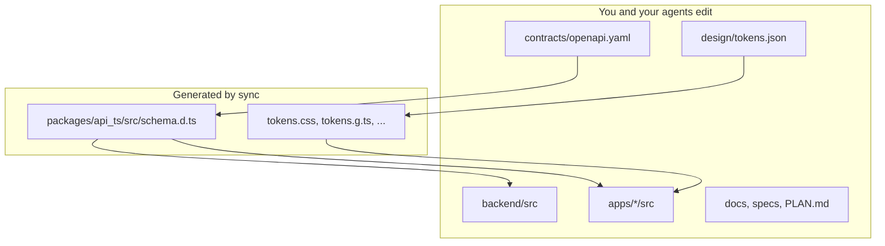

# Anatomy of a generated project

What `daedalus new shop --web spa --mobile rn --backend hono` writes, and what each file is for. Other stacks add their
own folder under `apps/`. Folders marked "generated" are rewritten by `deno task sync`: do not edit them.



```
shop/
  contracts/
    openapi.yaml            THE API. Every operation has an operationId and one tag.
  design/
    tokens.json             Colours (light and dark), radii, spacing, fonts. The look of every app.
  backend/                  Hono server on Deno (only with --backend hono)
    src/
      main.ts               Boot: config, database, modules, server, graceful shutdown
      app.ts                Middleware chain and module discovery
      modules/<feature>/    mod.ts, routes.ts, service.ts, repository.ts, schema.ts, tests/
      shared/               config, db, auth, errors, validation, logging, http, mail
    drizzle/                Committed SQL migrations (0000_init.sql ...)
    scripts/                seed.ts (demo data), diagrams.ts (ERD), modules-apply.ts
    Dockerfile              Container image for deploys
    deno.json               Backend tasks and pinned dependencies
  apps/
    web/                    One folder per app; the stack of each is in .blueprint.json
      src/
        app/routes.tsx      Composition only: routes and sign-in guards
        features/<name>/    ui/, state/, data/, model/, index.ts, tests next to the code
        shared/             api/ (the client wrapper), lib/, ui/
      docs/                 Screenshots and notes for this app
    mobile/                 React Native (Expo) in this example
      app/                  Expo Router routes: thin wrappers
      src/features/<name>/  Same layers as the web app
      src/shared/theme/     tokens.g.ts (generated)
  packages/
    api_ts/                 Generated TypeScript client, shared by backend and TypeScript apps (generated)
    ui/                     Shared web UI kit (shadcn-style components) and the tokens.css generator
  scripts/                  sync.ts, check.ts, lint-boundaries.ts, lint-deno-only.ts, secret-scan.mjs,
                            git-setup.mjs, timeline.mjs, daedalus.ts (bridge to the checkout), tokens/
    ai/                     ai-kit pack: spec.ts, guard.ts, sast.ts, audit.ts, sbom.ts and their tests
  specs/                    Spec-driven development: constitution.md, templates/, one folder per spec
  docs/
    ARCHITECTURE.md         Layers, features, boundaries, errors, tests, naming
    METHOD.md               The Daedalus Method: roles, cycle, Definition of Done
    AI-WORKFLOW.md          How people and agents split the work; briefing and review checklists
    RESPONSIBLE-AI.md       What AI must never do unattended; review gates
    AI-KIT.md, ROLE-PLAYBOOKS.md, DELIVERY-METRICS.md   From the ai-kit pack
    DATABASE.md, MODULES.md, OPERATIONS.md              Backend, modules, running in production
    adr/                    Architecture decision records (copy 0000-template.md)
    diagrams/               Mermaid diagrams (the database one is generated)
    QA.md                   Bug log in terms of what a user would see
    REPORT.md               Plain-language milestone updates
    CATALOG.md              Vetted open-source projects to reuse before building
  .claude/                  Skills (add-feature, plan-project, deploy, git-workflow ...) and agents
                            (backend-dev, web-dev, mobile-dev, design-reviewer ...), settings.json with the guard hook
  .gemini/commands/         Spec commands for Gemini CLI
  .agents/README.md         Design rules and how to restore the skills in skills-lock.json
  .github/                  workflows/ (ci, security, release, deploy), actions/, dependabot.yml, CODEOWNERS, ISSUE_TEMPLATE/,
                            PULL_REQUEST_TEMPLATE.md. Pipeline explained in docs/DEVSECOPS.md
  .gitlab-ci.yml            The same stages for GitLab
  .githooks/pre-commit      Secret scan, format and lint of staged files (installed by deno task setup)
  SECURITY.md               How to report a vulnerability
  .gitleaks.toml            Config for the optional gitleaks scan
  .blueprint.json           Which backend, database, UI preset, apps and extras (modules, packs) the project has
  .worktreeinclude          Local files (.env) copied into new git worktrees
  AGENTS.md CLAUDE.md GEMINI.md   Rules for AI agents; the last two point at AGENTS.md
  DESIGN.md                 The visual and verbal direction; the values live in tokens.json
  PLAN.md                   Product, milestones and what is next
  CONTRIBUTING.md CHANGELOG.md DISCLAIMER.md LICENSE README.md
  deno.json deno.lock       Workspace members, tasks, pinned dependencies
  skills-lock.json          AI skills to restore with deno task skills:update
```

## What reads what

| File | Read by |
|---|---|
| `contracts/openapi.yaml` | `deno task sync` (clients), the backend (validation), the contract-vs-route test |
| `design/tokens.json` | Each stack's token script during `deno task sync` |
| `.blueprint.json` | `sync`, `check`, `add-app`, AI agents (which apps exist) |
| `AGENTS.md` | Every AI agent, at the start of every session |
| `PLAN.md` | Agents (first unchecked milestone), `deno task timeline` |
| `specs/` | `spec:*` tasks and `spec:check` during `deno task check` |
| `docs/adr/`, `docs/QA.md`, `docs/REPORT.md` | People: decisions, bugs, stakeholder updates |

Apps never import each other. Generated files are never edited. Secrets never go in git: copy `.env.example` files to
`.env`, which is ignored.
