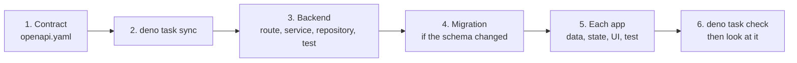

# Recipes

Step-by-step changes you will make again and again. Run commands from the generated project root unless a recipe says
it works in the Daedalus checkout. After every recipe: `deno task check`, then look at the running app.

Contents: [endpoint](#add-an-endpoint-end-to-end) | [feature module](#add-a-feature-in-each-stack) |
[language](#add-a-language) | [preset](#switch-the-ui-preset) | [module or pack](#add-a-module-or-a-pack) |
[own module](#write-your-own-module) | [own pack](#write-your-own-pack) | [own stack](#write-your-own-stack)

## Add an endpoint end to end

Always in this order, because each step feeds the next.



Example: list a note's tags, `GET /notes/{id}/tags`.

1. **Contract.** In `contracts/openapi.yaml` add the path with an `operationId` (camelCase verb and noun, such as
   `listNoteTags`) and exactly one `tags` entry. Put shapes under `components/schemas` with `required` listed. The tag
   becomes the group name in generated clients.
2. **Sync.** `deno task sync` regenerates `packages/api_ts` and the Dart client. If it fails, fix the YAML.
3. **Backend.** In `backend/src/modules/<feature>/`: `routes.ts` (HTTP only, validates from the contract), `service.ts`
   (rules), `repository.ts` (SQL, always scoped by `organizationId`), `schema.ts` (tables). Add a test in `tests/` with
   `createTestApp()` from `src/shared/testing.ts`. A test fails if a route is missing from the contract.
4. **Migration.** If tables changed: `deno task --cwd backend db:generate --name add_note_tags`, and commit the SQL in
   `backend/drizzle/`. `deno task --cwd backend diagrams` refreshes the database diagram.
5. **Each app.** Data layer over the generated client (the only place that talks to the network), then state, then UI with
   loading, empty and error states, plus a test. Features export through `index.ts` only.
6. **Check.** `deno task check`. Then run `dev:backend` and the app and use it.

## Add a feature in each stack

A feature is one folder with everything for one user-visible capability. Copy the existing `notes` feature and rename; it
is the reference. Every feature needs its three states and tests.

| Stack | Where | Files in the feature |
|---|---|---|
| Backend (Hono) | `backend/src/modules/<name>/` | `mod.ts`, `routes.ts`, `service.ts`, `repository.ts`, `schema.ts`, `tests/` |
| Web React (`web-spa`) | `apps/<web>/src/features/<name>/` | `data/`, `state/`, `ui/`, `model/`, `index.ts`, `<name>.test.tsx`; route in `src/app/routes.tsx` |
| Web Vue (`web-spa-vue`) | `src/features/<name>/` of the app | Same layers; public entry `index.ts` |
| React Native (`mobile-rn`) | `apps/<mobile>/src/features/<name>/` | `data/`, `state/`, `ui/`, `index.ts`; thin route file in `apps/<mobile>/app/` |
| Flutter (`mobile-flutter`) | `apps/<mobile>/lib/features/<name>/` | `data/` (repository), `presentation/` (pages), barrel `<name>.dart`; Riverpod providers |
| Desktop (`desktop-gpui`) | A feature crate in `apps/<desktop>/crates/` | See the stack README; boundaries are enforced between crates |
| Desktop (`desktop-tauri`), site (`web-site-astro`, `web-site-next`) | See each stack README | Reuse the web UI kit |

Rules checked by `deno task lint:boundaries`: another feature or app code imports yours only through its public entry
(`index.ts`, or `<name>.dart`); shared code goes in `shared/` (`core/` in Dart) and never imports a feature.

## Add a language

For user-facing text, use the `i18n` module: one JSON file per language shared by the backend and every app.

```
deno task add-module i18n
```

1. Copy `i18n/messages/en.json` to `i18n/messages/<locale>.json` (for example `de.json`) and translate the values.
   Keep keys and `{placeholders}` unchanged.
2. `deno task i18n:check` fails when a locale lacks a key, has an extra one, or changes placeholders. It is part of
   `deno task check`.
3. Read the module's doc (`docs/modules/i18n.md`) for how each stack loads the catalog. Plural rules are not built in;
   use one key per plural form or add ICU MessageFormat.
4. Have a native speaker review the text. Test long strings and right-to-left layouts before launch.

## Switch the UI preset

A preset is a ready-made `design/tokens.json`. At creation: `daedalus new shop --ui editorial`. Later, in a project:

1. See the choices: `daedalus list presets --json` (`clean`, `editorial`, `playful`) and inspect one with
   `daedalus describe preset editorial --json`.
2. Copy the preset's values into `design/tokens.json` (the presets live in the Daedalus checkout under
   `template/design/presets/`), keep the `meta` block out of your edits, update `DESIGN.md` to match.
3. `deno task sync` rewrites every app's theme. Look at light and dark mode in every app.

## Add a module or a pack

```
deno task add-module email,storage       # backend features
deno task add-pack fintech               # a domain or capability
```

Both never overwrite existing files. Afterwards: review the diff, `deno task sync`, `deno task check`, commit the new
migration in `backend/drizzle/` if the module added tables. Applied overlays are recorded in `.blueprint.json` under
`extras`, so later `sync` and `check` run their steps. Remove a module by deleting `backend/src/modules/<name>/` and its
unshipped migration. Packs for regulated areas are aids, not compliance (`DISCLAIMER.md`).

## Write your own module

Work in the Daedalus checkout. A module is one backend capability.

```
modules/<name>/
  module.json          manifest
  THIRD_PARTY.md       licences of everything it pulls in
  files/               copied into the project root, never overwriting
    backend/src/modules/<name>/{mod.ts, routes.ts, schema.ts, tests/, setup.json}
    docs/modules/<name>.md
```

Start by copying `modules/flags`. `module.json`:

```json
{
  "name": "notes-export",
  "title": "Notes export",
  "status": "thin",
  "summary": "One sentence for catalogs.",
  "requires": { "backend": true, "db": "postgres", "modules": [], "stacks": [] },
  "files": "files",
  "tasks": {},
  "install": [{ "cwd": ".", "run": "deno task --cwd backend modules:apply notes-export" }],
  "sync": [],
  "check": [],
  "routes": ["GET /notes/export"],
  "docs": "docs/modules/notes-export.md"
}
```

| Key | Meaning |
|---|---|
| `name`, `title`, `summary`, `status` (`full` or `thin`), `routes`, `ui`, `docs` | Description for people and catalogs |
| `files` | Folder copied into the project (default `files`) |
| `requires` | `backend`, `db` (`postgres`), `modules`, `stacks` that must be present |
| `tasks`, `install`, `sync`, `check` | Root tasks added; commands run after copying, during `sync`, during `check` |

`backend/src/modules/<name>/setup.json` is read by `modules:apply` and can merge `deno.imports` (pin exact versions), `env`
variables, a `contract` fragment (paths and components added to `openapi.yaml`), `database.authSchema`,
`database.migration`, and `ui.<stack>` copies. Default-export a `Module` from `mod.ts` (`setup`, `auth`, `middleware`,
`routes`, `start`, `stop`, all optional). Every route must exist in the contract fragment.

Check it: `deno test -A modules/modules_test.ts` (structure) and `deno run -A modules/verify.ts <name>` (builds a project,
installs, runs the backend's full check; slow). Full reference: `template/docs/MODULES.md`.

## Write your own pack

A pack adds a capability or domain: files, tasks, checks, agent rules.

```
packs/<name>/
  pack.json    manifest
  README.md    what it is, status, what is verified, what is missing
  rules.md     optional: appended to AGENTS.md under "## Pack: <name>"
  files/       copied into the project root, never overwriting
```

```json
{
  "name": "my-pack",
  "status": "starter",
  "description": "One or two sentences.",
  "stacks": ["any"],
  "files": "files",
  "rules": "rules.md",
  "tasks": { "mypack:verify": "deno run -A scripts/mypack/verify.ts" },
  "check": ["deno run -A scripts/mypack/verify.ts"],
  "requires": { "backend": false },
  "adds": { "files": ["scripts/mypack/verify.ts"], "checks": ["mypack:verify"] }
}
```

The generator reads `files`, `tasks`, `workspace`, `install`, `sync`, `check`, `requires`. People and tests read `name`,
`status` (`full` or `starter`), `description`, `stacks`, `default`, `rules`, `adds`. Rules: no file that exists in
`template/` or another pack, task names unique (`topic:verb`), Deno for JS and TS, tests next to the code, licences of
anything copied recorded in `THIRD_PARTY_NOTICES.md`. Check: `deno test -A packs/`.

## Write your own stack

A stack is one kind of app.

```
stacks/<id>/
  stack.json      manifest
  README.md       run, test, structure
  app/            sources copied to the app folder (appSource, default "app")
```

```json
{
  "id": "web-example",
  "kind": "web",
  "label": "Example web app",
  "defaultAppDir": "apps/web",
  "appSource": "app",
  "workspaceMember": true,
  "packages": ["packages/api_ts"],
  "tasks": { "dev:web": { "cwd": "{appDir}", "run": "deno task dev" } },
  "replace": [{ "files": ["package.json"], "from": "\"name\": \"web\"", "to": "\"name\": \"{appName}\"" }],
  "tokens": "deno run -A scripts/tokens/web.ts",
  "check": [{ "cwd": "{appDir}", "run": "deno task check" }],
  "boundaries": { "lang": "ts", "src": "src" },
  "requires": { "backend": "optional" }
}
```

| Field | Meaning |
|---|---|
| `id`, `kind` | Stack id; `web`, `mobile`, `desktop` (or `shared`) |
| `defaultAppDir`, `appSource` | Target folder, and the folder inside the stack that is copied |
| `workspaceMember` | Add the app to the root `deno.json` workspace (TypeScript apps) |
| `packages` | `packages/api_ts` (base), `stack:<path>`, `shared:<stack>/<path>` |
| `tasks` | Merged into the root `deno.json`; `{appDir}`, `{appName}` replaced |
| `replace`, `placeholders`, `move` | Name, bundle id and display-name substitutions |
| `install`, `sync` | Commands after copying and during `deno task sync` |
| `tokens` | Script or command that writes the app's theme from `design/tokens.json` |
| `check` | Commands `deno task check` runs for the app |
| `audit` | `{ "ignore": ["GHSA-..."], "reason": "..." }` for dev-only advisories; the reason is required |
| `boundaries` | `{ "lang": "ts" or "dart", "src": "<folder>" }` for `lint:boundaries` |
| `requires` | `{ "backend": "optional" }` |

Also: add the flag mapping in `stacksFromFlags` (schema in `lib/blueprint.ts`) and a CI matrix entry, as
`CONTRIBUTING.md` says. Then prove it: `daedalus new <scratch folder> --web <flag> --yes` must end with a green check.
