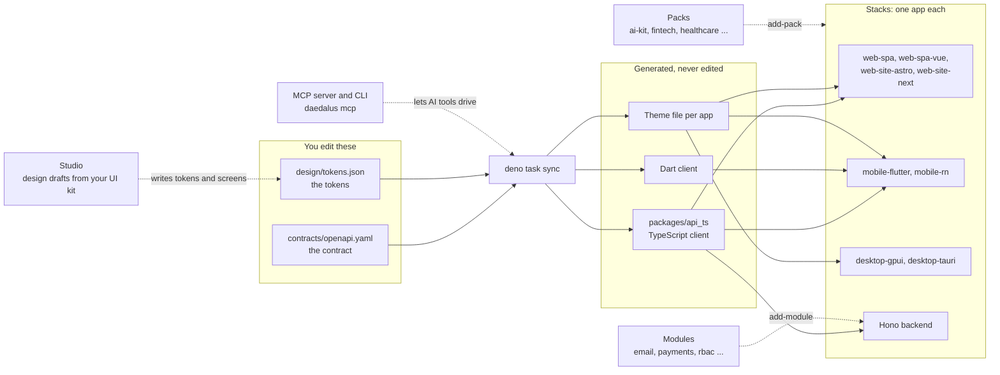

# How the pieces fit

Read it left to right: you change a contract or a token, `sync` regenerates everything that depends on it, and the
stacks consume the result. Modules extend the backend, packs add whole capabilities, and Studio and MCP are two more
ways to drive the same files.
