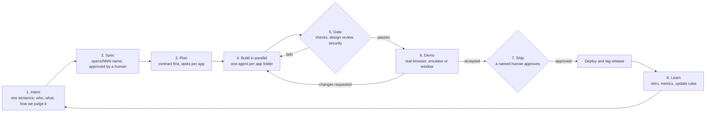

# The Method cycle

One change travels from an idea to a shipped, measured result. Humans decide at the diamonds; agents do the work
between them. See [METHOD.md](../METHOD.md).

Rules of thumb: a small fix may skip steps 2 and 3, but never step 5. Nothing leaves step 7 without a person.
