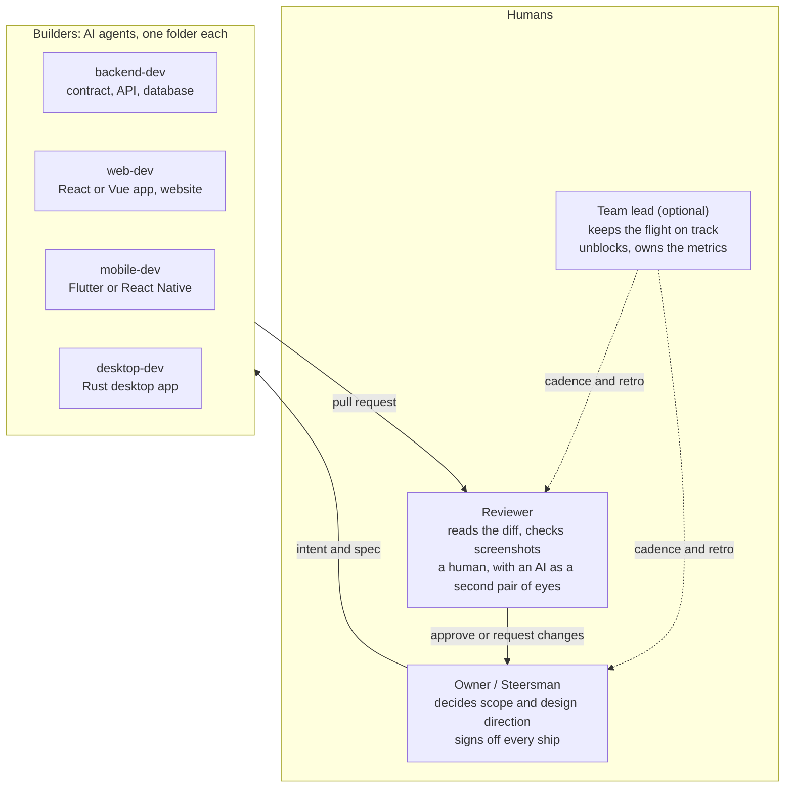

# Roles and responsibilities

Who decides, who does, who reviews. One person can wear several hats; an AI agent never wears the Owner hat.

| Who | Decides | Does | Reviews |
|---|---|---|---|
| Owner | What and why, scope, trade-offs, ship | Writes the intent, approves the spec | The demo and the release notes |
| Builders | Nothing outward-facing | Plan, code, tests, regenerate clients | Their own output with `deno task check` |
| Reviewer | Approve or reject a change | Reads diffs, looks at screenshots | Every pull request |
| Team lead | Cadence, who reviews what | Unblocks, runs the retro | The metrics trend |
