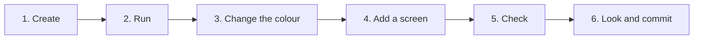

# Your first app in 30 minutes

You will create a notes app with a website-style web app and a mobile app, run it, change its colour in one place, add a
screen, and run the checks. Every command below was run once on a clean folder.

**Before you start:** [install](install.md) Git and Deno 2.9 or newer, and clone Daedalus. In the examples the Daedalus
folder is `daedalus` and your project goes next to it. Commands starting with `daedalus` can be replaced by
`deno run -A cli.ts` run from inside the Daedalus folder.



## 1. Create the project (5 minutes)

```
daedalus new notes --name "Acme Notes" --id com.example.notes --web spa --mobile rn --backend hono --yes
```

What the flags mean: `--web spa` is a React web app, `--mobile rn` is a React Native mobile app, `--backend hono` is
the server, `--id` is the app's unique name for the app stores, `--yes` accepts defaults for everything you did not
say. The command copies the template, installs packages, generates the API client and the theme, and finishes with a full
check. Expect a few minutes; the mobile tests are the slowest part. Add `--no-check` to skip that final check now (you
will run it yourself in step 5).

When it ends you have a folder `notes` next to `daedalus`:

```
cd notes
```

Skim these three files. They are short and everything else follows from them:

| File | What it is |
|---|---|
| `AGENTS.md` | The rules your AI assistant follows. Write one paragraph under "This project". |
| `DESIGN.md` | How the app should look and sound. |
| `PLAN.md` | Milestones. Agents work the first unchecked one. |

The project already contains a working example, "notes": sign in, a list with search, a detail page, a create form.

## 2. Run it (5 minutes)

Use three terminals, all in the `notes` folder.

```
deno task dev:backend       # terminal 1: the server on http://localhost:8787
deno task dev:web           # terminal 2: the web app on http://localhost:5173
deno task dev:mobile        # terminal 3: the mobile app (Expo)
```

- The backend keeps its data in a small local database, so you need no database server. Optional demo data:
  `deno task --cwd backend seed`, then sign in as `ada@example.com` with password `password1234`.
- Open http://localhost:5173 and sign in or create an account. Open http://localhost:8787/docs to see the API
  reference that was built from your contract.
- Mobile: after `dev:mobile`, press `w` for a browser version, `a` for an Android emulator, or scan the code with the
  Expo Go app on your phone. Phones and emulators need to reach your PC: see [troubleshooting #14](troubleshooting.md#14-the-mobile-app-cannot-reach-the-backend).

Stop any server with Ctrl+C.

## 3. Change the colour (3 minutes)

Every colour lives in one file. Open `design/tokens.json` and change the light-mode `primary`:

```json
"primary": "#0f766e",
```

Then regenerate the themes:

```
deno task sync
```

It prints which files it wrote: the web app's `packages/ui/src/styles/tokens.css` and the mobile app's
`apps/mobile/src/shared/theme/tokens.g.ts`. Reload the web app: buttons and links are now teal, on web and mobile at
once. That is the point of tokens: you never hunt through screens for colours.

Want a different overall feel? Pick a preset when creating a project: `--ui clean`, `--ui editorial` or `--ui playful`.
See them with `daedalus list presets --json`.

## 4. Add a screen (10 minutes)

Pick one way.

**A. Ask your AI assistant.** Open the `notes` folder in your AI tool and write a brief ([how](working-with-ai.md)):

```
Goal: signed-in users can pin a note so it stays at the top of the list.
Scope: contract, backend, apps/web and apps/mobile.
Follow the order in AGENTS.md: contract first, then deno task sync, then backend, then each app.
Done when: deno task check passes, pinned notes show first, empty and error states still work.
List your assumptions and your plan before you write code.
```

For anything bigger, write a spec first so the idea is reviewed before code exists:

```
deno task spec:new pinned-notes "Pin notes"
```

This creates `specs/001-pinned-notes/spec.md` and `acceptance.md`. Fill them in with the assistant, set the status to
approved, then `deno task spec:plan pinned-notes` and `deno task spec:tasks pinned-notes`.

**B. Explore the design in Studio first.**

```
deno task studio
```

Studio starts a local page at http://127.0.0.1:4310 where you can draft design directions and screens from your project's
UI kit before anything is built. Details: `docs/STUDIO.md` in the Daedalus folder.

**C. By hand.** Follow "Changing an API: always in this order" in `AGENTS.md`: edit `contracts/openapi.yaml`, run
`deno task sync`, change the backend (`backend/src/modules/notes`), then the data layer, state and UI of each app, with a
test for each.

## 5. Run the checks (5 minutes)

```
deno task check
```

This is the inspector. It regenerates code, checks feature boundaries, the Deno-only rule, known vulnerabilities, then the
backend and each app: types, lint, tests, build. When it ends with `All checks passed.` you are green. If something is
red, read the first error, fix it (or paste it to your assistant), and run it again. To check a single app while you
work: `deno task check web`.

## 6. Look at it, then save it

Open the web app at a narrow width (a phone-sized window) and a wide one, and try the empty, loading and error states.
A passing check is necessary but not enough: you have to see it.

To use Git you must choose who the commits belong to:

```
deno task git:setup --name "Your Name" --email you@example.com
```

Nothing is committed until you do this on purpose.

## You made it. What next?

- Add a backend feature: `deno task add-module email` ([modules](../../template/docs/MODULES.md))
- Add another app: `deno task add-app web-site-astro site` for a marketing website
- Learn the way of working: [the Daedalus Method](../METHOD.md)
- Look things up: [cheatsheet](../dev/cheatsheet.md), [glossary](glossary.md), [FAQ](faq.md)
