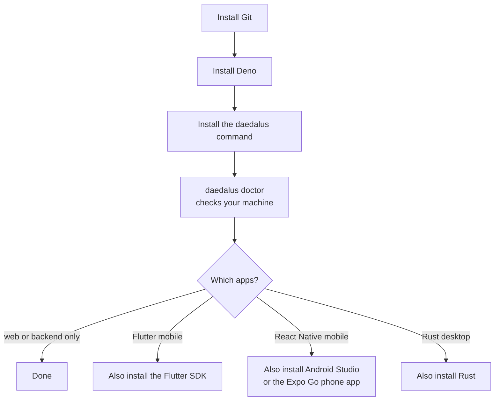

# Install

You need three things: **Git**, **Deno** and a **code editor**. Mobile and desktop apps need one extra tool each, but
you can skip those until you want that kind of app. Plan 10 minutes.



## 1. Git

Git keeps the history of your files. Check whether you have it:

```
git --version
```

If you see a version number, skip ahead. Otherwise:

| System | Command or download |
|---|---|
| Windows | `winget install --id Git.Git -e` or the installer from https://git-scm.com |
| macOS | `xcode-select --install` (or `brew install git`) |
| Linux (Debian, Ubuntu) | `sudo apt install git` |

Open a **new** terminal window afterwards so it picks up the change.

## 2. Deno

Deno is the one tool that runs everything JavaScript and TypeScript in Daedalus. There is nothing else to install for
that part: no Node, no npm.

| System | Command |
|---|---|
| Windows (PowerShell) | `irm https://deno.land/install.ps1 \| iex` or `winget install DenoLand.Deno` |
| macOS | `brew install deno` or `curl -fsSL https://deno.land/install.sh \| sh` |
| Linux | `curl -fsSL https://deno.land/install.sh \| sh` |

Open a new terminal and check:

```
deno --version
```

You need **Deno 2.9 or newer**. If it is older, run `deno upgrade`. If the command is "not found", see
[troubleshooting](troubleshooting.md#1-deno-is-not-recognized-or-command-not-found).

## 3. Install the `daedalus` command

Pick the easiest one for you. None needs administrator rights.

| You have | Run |
|---|---|
| Windows (PowerShell) | `irm https://github.com/Hagalaz2001/Daedalus-framework/releases/latest/download/install.ps1 \| iex` |
| macOS or Linux | `curl -fsSL https://github.com/Hagalaz2001/Daedalus-framework/releases/latest/download/install.sh \| sh` |
| Deno already (any system) | `deno install -g -A -n daedalus jsr:@daedalus-framework/cli` |

The first two download a ready-made program, check its checksum against the one published with the release, and add it
to your PATH. Open a **new** terminal afterwards and check:

```
daedalus --version
```

The first time you create a project, `daedalus` downloads the templates that belong to its version (about 25 MB, once,
checked the same way) and keeps them in your user folder (`~/.daedalus` on macOS and Linux, `%LOCALAPPDATA%\daedalus` on
Windows). After that it works offline. To update everything later: `daedalus upgrade`.

If `daedalus` is "not found" after the JSR install, add `~/.deno/bin` to your PATH ([troubleshooting](troubleshooting.md#2-daedalus-is-not-found-after-installing-it)).

### Or from the source code

If you want to read or change Daedalus itself:

```
git clone https://github.com/Hagalaz2001/Daedalus-framework.git daedalus
cd daedalus
deno install -g -A -n daedalus cli.ts
```

Put the folder somewhere permanent, for example `~/daedalus`: generated projects find it there. Without the last line, use
`deno run -A cli.ts` wherever this guide says `daedalus`, from inside the `daedalus` folder.

## 4. Check your machine

```
daedalus doctor
```

It prints what your computer can do and what is missing, including whether it can run a local AI model. It exits with an
error only when the minimum is not met.

## 5. Tools for the kind of app you want

| You want | Install | Check |
|---|---|---|
| Website, web app, backend | Nothing more | |
| Mobile with **React Native** | A phone with the Expo Go app, or [Android Studio](https://developer.android.com/studio) for an emulator | `deno task dev:mobile` later |
| Mobile with **Flutter** | [Flutter SDK](https://docs.flutter.dev/get-started/install) | `flutter doctor` |
| Desktop with **Tauri or GPUI** | [Rust](https://rustup.rs) | `cargo --version` |
| iPhone apps | A Mac with Xcode (Apple's rule, not ours) | |

## 6. An editor and an AI assistant

Any editor works; [VS Code](https://code.visualstudio.com) is a good default. For an AI coding assistant, use any tool
that reads `AGENTS.md` (Claude Code, Codex, Gemini CLI, Cursor and others). Daedalus does not require a specific one.
See [Working with an AI assistant](working-with-ai.md).

Next: [Your first app in 30 minutes](first-app.md).
