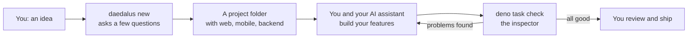
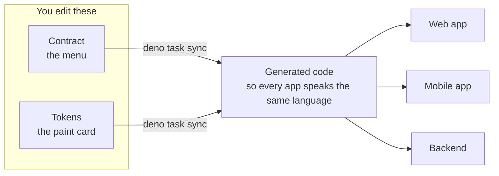

# What is Daedalus?

Daedalus helps you build an app, a website, or both, without starting from an empty folder. You answer a few questions,
it writes a complete, tidy project, and your AI assistant (or you) fills in the parts that are special to your idea.

## The one-minute picture

Think of building a house. You would not start by mixing concrete. You start from a set of plans, standard parts, and a
checklist an inspector will use. Daedalus is the plans, the parts and the inspector for software.

## Five words you will see everywhere

| Word | Everyday picture | What it really is |
|---|---|---|
| **Contract** | The menu a restaurant hands out: the kitchen and the diners both agree on what can be ordered. | One file, `contracts/openapi.yaml`, that lists every request your apps can make to the server and what comes back. Both sides are generated from it, so they cannot disagree. |
| **Tokens** | A paint swatch card for the whole house: change "wall colour" once and every room follows. | One file, `design/tokens.json`, with your colours, corner roundness, spacing and fonts. Every app reads from it. |
| **Stack** | A type of building: a house, an office, a shed. Each is built with different materials. | The set of tools for one kind of app, for example "web app with React" or "mobile app with Flutter". You pick one or more. |
| **Module** | A room you add later, like a garage or a guest room. | An optional feature, such as email, payments or user roles, that you add to the server with one command. |
| **Pack** | A themed toolbox: the electrician's kit, the plumber's kit. | A bundle of files and rules for a whole area, such as the AI delivery kit, finance, healthcare or EU compliance. |

## Where the pieces fit

Full version: [How the pieces fit](../diagrams/how-it-fits.md).

## What Daedalus does not do

- It does not write your product for you. You (or your AI assistant) still decide what to build and review every change.
- It does not ship anything on its own. Deploying, publishing to app stores and spending money always need a person.
- It is not a hosted service. Everything runs on your computer and the result is a normal folder of code you own.

## How AI fits in

Every project comes with instructions for AI coding assistants (`AGENTS.md`), a checklist they must follow, and the same
inspector (`deno task check`) that you use. The working method is described in the [Daedalus Method](../METHOD.md), and
[Working with an AI assistant](working-with-ai.md) shows how to ask well.

## Next

1. [Install what you need](install.md)
2. [Your first app in 30 minutes](first-app.md)
3. Stuck on a word? [Glossary](glossary.md)
