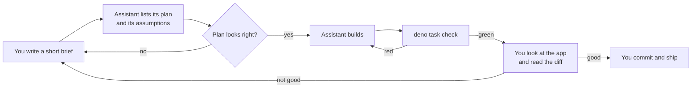

# Working with an AI assistant

An AI assistant is a very fast junior colleague: it types in seconds, it sometimes invents things, and it never carries
responsibility. You do. This page shows how to ask well and what to check. The full rules are in
`docs/AI-WORKFLOW.md` and `docs/RESPONSIBLE-AI.md` in every project, and the working method is the
[Daedalus Method](../METHOD.md).

## Setting up

1. Open the **project folder** (not the Daedalus folder) in your AI tool. It reads `AGENTS.md` by itself.
2. Fill in the "This project" section of `AGENTS.md`, `DESIGN.md` and the "Product" part of `PLAN.md`: who it is for, what
   it feels like. A tool cannot guess your taste.
3. Keep your tool's permission mode cautious. Approve commands you understand.

## How to brief it

A good brief is short and checkable. Five parts:

| Part | Example |
|---|---|
| **Goal and user** | "Signed-in users can search their notes by title." |
| **Scope** | "Change the backend and `apps/web` only. Do not touch the contract's other endpoints." |
| **Done when** | "`deno task check` passes; an empty search shows the empty state; it works at 390 px wide." |
| **Constraints** | "Reuse the existing list component. Read `DESIGN.md` first." |
| **Unknowns** | "I am not sure whether search should be case sensitive. List your assumptions before coding." |

Tips that save hours:

- One task per session. Big jobs become a spec first: `deno task spec:new search-notes`.
- Ask for a plan before code, and approve it.
- Paste the real error text instead of describing it.
- Ask: "What did you not verify?"
- When the assistant goes wrong twice, stop arguing. Fix the brief or the rule file and start again.

## Prompts to start from

- "Read AGENTS.md and PLAN.md, then tell me the first unchecked milestone and your plan. Do not write code yet."
- "Add a `tags` field to notes. Follow the contract-first order in AGENTS.md. Show me the contract change before building."
- "Run `deno task check` and fix what fails. Do not disable any check."
- "Review this diff as a sceptical reviewer. List bugs, missing tests and anything that does not follow ARCHITECTURE.md."

## What you must check yourself

- [ ] It runs: you opened the app and used the change, on a narrow and a wide screen.
- [ ] `deno task check` is green and nobody weakened a check to get there.
- [ ] You read the diff, including new dependencies (are they real, maintained, licensed, pinned?).
- [ ] Tests would fail if the feature broke. Read what they assert.
- [ ] No secrets, no real customer data in prompts, files or screenshots.
- [ ] No hard-coded colours or spacing; the design follows `DESIGN.md`.
- [ ] The assistant did not touch generated files or files outside the scope you gave it.

## Things it must never do alone

Deploy, publish, send messages to real users, spend money, delete data, change who can sign in, touch production secrets,
force-push. It may prepare these and show you the command. You run it. Details: `docs/RESPONSIBLE-AI.md`.

## Using the tools that ship with the project

| Tool | Use |
|---|---|
| `deno task spec:new <name>` | Write what and why before code |
| Skill `add-feature` (Claude Code) | Builds a feature across backend, web and mobile in parallel |
| Skill `plan-project` | Turns a product description into milestones in `PLAN.md` |
| Skill `ai-review` and agent `design-reviewer` | A second look at a change and at screenshots |
| `daedalus mcp` | Lets MCP-capable tools call `add-app`, `add-module`, `check` and more ([INTEGRATIONS](../INTEGRATIONS.md)) |
| `deno task studio` | Explore design directions and screens before asking an agent to build them |
