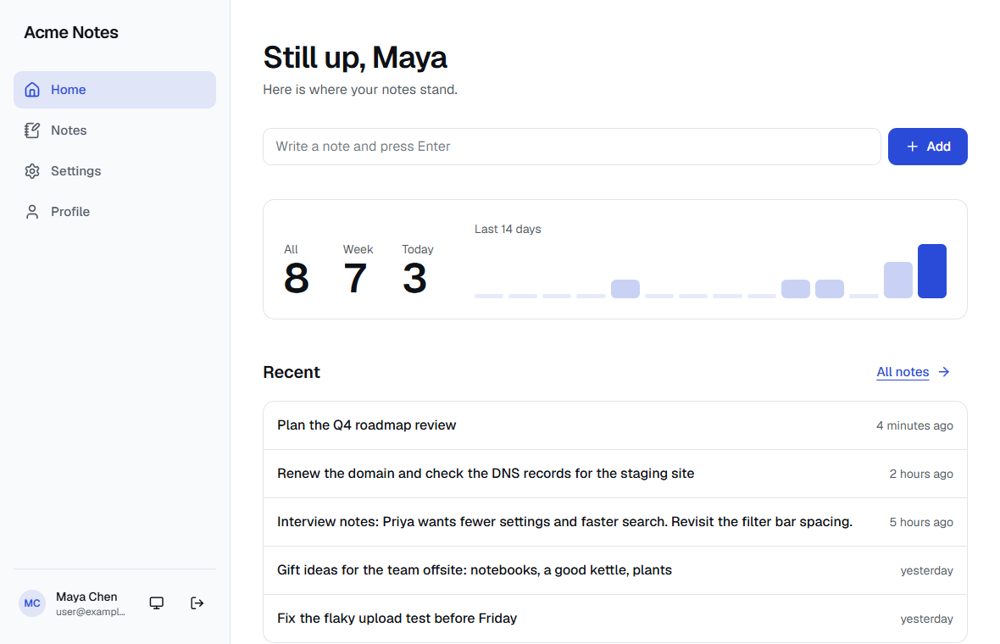
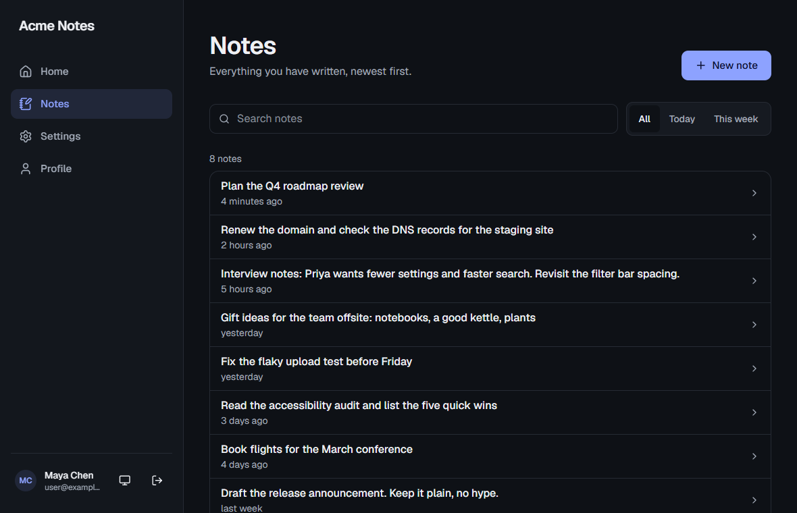
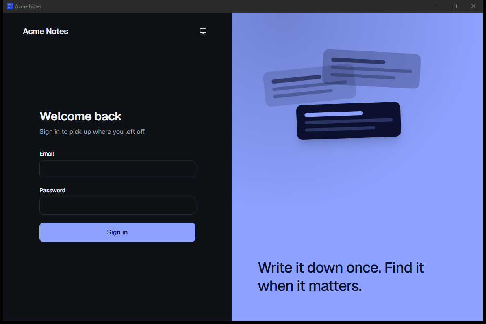

# desktop-tauri: Tauri v2 desktop app

A desktop app with a small Rust shell (Tauri v2, system webview) around the same React + TypeScript UI kit the web
stacks use. No Electron, no bundled Chromium, no Node at runtime, and pure Deno for the frontend toolchain.

## Tauri or GPUI?

| Pick | When |
|---|---|
| **desktop-tauri** (this) | The product also has a website or web app and should share its UI kit, tokens and screens, or it has to ship fast. Web developers can work on it. |
| **desktop-gpui** | Lowest memory, native rendering, a long-lived tool that sits open all day, no webview dependency. Everything is Rust. |

## What you get

Screens (same feature-first structure as web-spa): sign in, dashboard, notes list with search and date filter, note
detail with delete, create and edit form, settings (light, dark, system theme and the server in use), profile (name,
sign out), not found. Every data screen has loading, empty and error states.

Desktop specifics:

- **Bearer-token sign-in.** Better Auth returns the token in the `set-auth-token` header; the app sends it as
  `Authorization: Bearer <token>`. Cookies are not used (they do not work from the webview's origin).
- **Token in the OS credential store** (Windows Credential Manager, macOS Keychain, Secret Service) through the Rust
  `keyring` crate behind three commands. It is never written to localStorage or a file.
- **Rust-side HTTP.** The API client's `fetch` is `tauri-plugin-http` (reqwest), so the webview's CORS rules do not
  apply and the backend needs no CORS entry for the desktop app. Allowed origins are listed in
  `src-tauri/capabilities/default.json`.
- **No white flash in dark mode.** The window starts hidden and is shown after the first paint. The shell saves the
  theme choice and the page background colour (read from the design tokens) and applies them to the title bar and
  window background at the next launch before anything is drawn.
- **Single instance** (a second launch focuses the running window) and **window size/position memory**.
- **Shortcuts:** Ctrl/Cmd+1..4 switch screens, Ctrl/Cmd+N new note, Ctrl/Cmd+, settings, Ctrl/Cmd+Shift+L toggles
  light/dark.
- **Least privilege.** The main window may call only its five own commands plus HTTP to the listed origins. No shell,
  no file system, no opener plugin. CSP: `default-src 'self'`, connect only to the IPC channel.

## Layout

```
app/                      copied to apps/desktop
  src/                    frontend (same layers as web-spa)
    app/                  routes, desktop shortcuts, native theme sync
    features/<x>/         auth, dashboard, notes, settings, profile: ui/ state/ data/ model/, public entry index.ts
    shared/api            the one place the typed client is created (Rust-side fetch, bearer middleware)
    shared/lib            native command bridge, token, formatting
  src-tauri/
    src/session.rs        token store trait, OS keyring implementation, in-memory fallback, commands
    src/settings.rs       theme and colour preferences (pure logic) and the settings file
    src/shell.rs          window theme, show after paint, focus on second launch, commands
    src/lib.rs            wiring only
    capabilities/         the permission list
    tauri.conf.json       window, CSP, NSIS bundle
```

Rule: features import other features only through `index.ts` (enforced by `deno task lint:boundaries` at the project
root). On the Rust side each concern is one module with its own commands; `lib.rs` only registers them.

## Requirements

Rust (1.88 or newer), Deno, and the Tauri CLI. The CLI is the Rust one, so Node is never needed:

```sh
deno task setup:desktop      # cargo install tauri-cli --version 2.12.5 --locked  (a few minutes, once)
```

Windows needs WebView2 (present on Windows 10/11) and the MSVC build tools. macOS needs Xcode command line tools;
Linux needs webkit2gtk (see the Tauri prerequisites page).

## Commands (from the project root)

```sh
deno task sync               # API client and theme from design/tokens.json
deno task dev:backend        # the API on :8787
deno task dev:desktop        # cargo tauri dev: Vite on :1420 plus the app window
deno task build:desktop      # cargo tauri build: release exe and the NSIS installer
deno task check              # includes this app's checks
```

The app's own check (`deno task --cwd apps/desktop check`) is typecheck, oxlint, Vitest and a production build.
`deno task check` also runs, in `src-tauri`: `cargo fmt --check`, `cargo clippy --all-targets --locked -- -D warnings`
and `cargo test --locked`. The frontend build must run first because Tauri embeds `dist/`; the order in `stack.json`
does that. `cargo test -- --ignored` also exercises the real OS credential store.

Keep Cargo's build output out of the repository if you like: set `CARGO_TARGET_DIR` to a folder elsewhere
(`src-tauri/target` is git-ignored either way).

## Point it at your backend

- Build-time server: `VITE_API_BASE_URL` (default `http://localhost:8787`).
- Add that origin to `src-tauri/capabilities/default.json` (`http:default` allow list). Requests to any other origin
  are refused by the Rust side.
- The backend needs the Better Auth `bearer` plugin (the Hono template has it).

## Packaging

`cargo tauri build` produces an unsigned **NSIS** installer on Windows
(`target/release/bundle/nsis/<name>_<version>_x64-setup.exe`, per-user install, no admin rights). Unsigned installers
show a SmartScreen warning until you sign them (a certificate is a paid item). macOS and Linux: change
`bundle.targets` in `tauri.conf.json` (`dmg`/`app`, `deb`/`appimage`) and build on that OS. The icon is generated from
one source image: `cargo tauri icon your-icon.png`. The release profile uses LTO, one codegen unit, `opt-level = "s"`,
stripped symbols and `panic = "abort"`.

**Auto-update is not enabled.** To add it: `cargo add tauri-plugin-updater`, register it in `lib.rs`, add its
permission and a signing key pair, publish update manifests. That is a deliberate step because it needs your key and
a place to host releases.

## Measured on the development machine (Windows 10, release build)

| | Result |
|---|---|
| Release exe | 6.1 MiB (6,377,472 bytes) |
| NSIS installer | 2.39 MiB |
| Idle memory (sign-in screen, 20 s after launch) | 7 processes (app + WebView2): Working Set summed 371 MB, private bytes summed 199 MB |

How it was measured: the release exe was started on a private Windows desktop (`CreateDesktop`, never displayed, so nothing
appeared on screen or the taskbar), waited 6 s, captured its window with `PrintWindow`, waited 20 s more, then summed
`WorkingSet64` and `PrivateMemorySize64` over the app process and every descendant (`msedgewebview2.exe`) and terminated
the tree. Summed Working Set counts pages shared between the WebView2 processes more than once, so private bytes is the
fairer number. Sign-in screen only, no data loaded; one run.

For scale, public Electron figures vary widely: about 168 MB idle for one window in
[this write-up](https://dev.to/gethopp/tauri-vs-electron-performance-bundle-size-and-the-real-trade-offs-1el4),
128 MB in a [Better Stack comparison](https://betterstack.com/community/guides/scaling-nodejs/tauri-vs-electron-vs-deno-vs-electrobun/),
and a Windows 11 test that found Electron and Tauri close (149 vs 142 MB). Those are other people's measurements with other
methods and are **not** comparable to the figure above; no Electron app was measured here. Take away: on Windows a Tauri
app is not dramatically lighter than Electron at idle, because WebView2 is also Chromium. Its wins are the 2.4 MiB installer
and the small binary; for the lowest memory pick `desktop-gpui`.

## Verified, and not verified

Verified from a freshly generated project (`deno run -A new-project.ts <dir> --desktop tauri`): frontend typecheck,
lint, 14 Vitest tests, production build; Rust fmt, clippy with warnings denied, 6 unit tests plus the ignored test
against the real Windows Credential Manager (passes); `cargo tauri build` end to end including the NSIS installer.

## Screenshots

Captured with headless Edge (Playwright) against the built `dist/` at the app's window size (1180 x 760), with the API
mocked in the page and the native layer absent. They show **app UI (web view content)** only: no title bar, no
window chrome, no native behaviour. Files are in `docs/screenshots/`: `sign-in`, `dashboard`, `notes`, `note-detail`,
`note-form`, `settings`, `profile`, `not-found`, each as `-light` and `-dark`.




One capture of the real native window (title bar, WebView2 content), taken off-screen on the private desktop:



**Not verified:** the installer was built but never run, there was no sign-in against a running backend through the Rust HTTP
plugin, and the window was seen only in the one off-screen capture above (the hidden-until-painted logic and the title bar
theme behaved as designed there, but were not exercised further). macOS and Linux were not built. Auto-update is not wired.

## Limits

- The notes list reads the first 100 notes; add cursor paging (`X-Next-Cursor`) for more.
- No sign-up, password reset or account deletion screens: do those on the website or add them from web-spa.
- Minimum window width is 1024 px because the shared kit switches to a phone layout below that.
- Theme choice is also kept in the webview's localStorage (the kit does this); the Rust file only drives the native
  window chrome.
