# DevSecOps: how this project is built, checked and shipped safely

Plain language first, details after. Everything here is already wired into the project; this page explains what it does
and what you must switch on once. Replace `OWNER/REPO` with your repository. Links to `OPERATIONS.md` and `DATABASE.md`
apply to projects that have a backend.

## In plain words

- Every change goes through a **pull request**. Robots check it before a human merges it: do the tests pass, did someone
  paste a password, does a new library have a known hole or a licence we cannot use, does the Docker image contain known
  vulnerabilities.
- Nothing reaches users automatically except **staging** (a private rehearsal copy), and only after the checks pass.
  **Production** needs a named person to press approve.
- Releases are numbered (`v1.2.0`), come with a changelog, a list of everything inside (SBOM) and a signed proof of
  where they were built (provenance), so anyone can verify a download was not tampered with.
- Secrets (passwords, API keys) live only in the hosting platform's secret store, one set per environment. Never in git.
- **Deployment is switched off** until you configure it. Merging code never deploys by accident.

### What you do once (about 30 minutes)

| # | Step                                                                                                         | Where                                       |
| - | ------------------------------------------------------------------------------------------------------------ | ------------------------------------------- |
| 1 | `deno task setup` (installs the commit hook, writes the dependency-update file)                              | your computer                               |
| 2 | Replace the placeholders in `.github/CODEOWNERS` and `SECURITY.md`                                           | the repository                              |
| 3 | `deno task protect-branch`: read the printed commands, run them (branch protection, secret scanning, alerts) | your terminal, signed in with `gh` / `glab` |
| 4 | Private repository on GitHub? Decide on code scanning (see [Private repositories](#private-repositories))    | Settings > Code security                    |
| 5 | When you are ready to deploy: [Turning deployment on](#turning-deployment-on)                                | Settings > Environments                     |

Skip step 5 for now if you only build and test: the project is fully usable without deploying.

## The pipeline

```mermaid
flowchart LR
  dev[Developer commit] --> hook[Local hook: secrets, format, lint]
  hook --> pr[Pull request]
  pr --> ci
  subgraph ci[Checks on every pull request]
    direction TB
    check[check: lint, types, tests, boundaries, audit]
    secrets[secrets: gitleaks]
    dep[dependency review]
    sast[CodeQL + ai-kit rules]
    sbom[SBOM]
    cont[container build + Trivy scan]
  end
  ci --> req{required job green?}
  req -- no --> fix[Fix and push again]
  req -- yes --> merge[Review + merge to main]
  merge --> stg[Deploy staging: automatic if enabled]
  merge --> tag[deno task release: changelog + tag vX.Y.Z]
  tag --> rel
  subgraph rel[Release workflow]
    direction TB
    build[Build artifacts] --> prov[Signed provenance]
    build --> img[Signed image on GHCR if enabled]
    build --> gh[GitHub release + SBOM]
  end
  rel --> prod[Deploy production: manual dispatch + named approver]
```



Files: `.github/workflows/ci.yml` (checks), `security.yml` (CodeQL and a weekly deep scan), `release.yml` (tags),
`deploy.yml` (deployment templates). GitLab users get the same stages in `.gitlab-ci.yml`.

## What each check protects against

| Check (job)                          | Protects against                                                                            | Runs               | If it is red                                                                                            |
| ------------------------------------ | ------------------------------------------------------------------------------------------- | ------------------ | ------------------------------------------------------------------------------------------------------- |
| `check` (`deno task check`)          | Broken code, type errors, architecture rule breaks, npm usage, known-vulnerable packages    | every PR and main  | Open the log, find the first `>` line that failed, run the same command locally                         |
| `secrets` (gitleaks)                 | A password, key or token committed to git (it stays in history forever)                     | every PR and main  | Treat the secret as leaked: [rotate it first](#if-a-secret-was-committed), then remove it from the code |
| `dependency-review`                  | A pull request adding a package with a known serious vulnerability or a copyleft licence    | PRs                | Pick another package or version; an exception needs a maintainer's written reason                       |
| `codeql` (`security.yml`)            | Injection, unsafe HTML, path traversal, unsafe workflow files (found by data-flow analysis) | PRs, main, weekly  | Open the alert under Security > Code scanning; fix the flagged line or dismiss with a written reason    |
| `sast` rules (ai-kit pack)           | Patterns AI assistants often write: `eval`, unescaped HTML, shell built from input          | inside `check` job | The message names the rule and line; mark a reviewed exception with `sast:allow <rule-id>`              |
| `sbom`                               | "Which versions are we running?" when a new vulnerability is announced                      | every PR and main  | Rarely fails; if it does, it is a tooling error, re-run                                                 |
| `container` (Trivy)                  | Known vulnerabilities in the base image and libraries; risky Dockerfile settings            | every PR and main  | Update the base image tag in `backend/Dockerfile`; unfixable and reviewed items go in `.trivyignore`    |
| `required`                           | A merge with any red check                                                                  | every PR           | It only reports the others                                                                              |
| Local hook (`scripts/pre-commit.ts`) | Secrets and style problems reaching the repository at all                                   | every `git commit` | Fix the lines it prints; `git commit --no-verify` skips it once (CI will still catch it)                |
| Weekly deep scan                     | New vulnerabilities in code that did not change                                             | Mondays            | Same as the matching check above                                                                        |

## Reading a failed run

1. Open the pull request, click **Details** next to the red check.
2. Expand the red step. The first error is the cause; later lines are usually fallout.
3. `check` failures: run `deno task check` locally, which does the same thing. For one folder:
   `deno task check <folder>`.
4. Gitleaks prints the file, line and rule, with the secret hidden (`REDACTED`).
5. Trivy prints a table: package, installed version, **fixed version**. Upgrade to the fixed version.
6. Still stuck: copy the failing step's last 30 lines into the issue or to your AI assistant, without secrets.

## Turning deployment on

Deployment stays off until **all** of this is done. Nothing below is stored in git.

1. **Choose a target** and add it to `scripts/ci/deploy.ts` ([Adding a deploy target](#adding-a-deploy-target)).
2. **Create the environments**: Settings > Environments > `staging` and `production` (or `deno task protect-branch`,
   which prints the commands).
   - `production`: tick **Required reviewers** and add a named person (not "everyone"); tick **Prevent self-review**;
     under **Deployment branches and tags** allow only release tags (`v*`).
   - `staging`: allow only the `main` branch.
3. **Add the secrets to each environment** (Settings > Environments > _name_ > Environment secrets), never to the
   repository. A different value per environment. For the backend these are what `docs/OPERATIONS.md` lists as required
   in production, plus your host's deploy credential:

   | Secret (per environment)                                             | What it is                                                         |
   | -------------------------------------------------------------------- | ------------------------------------------------------------------ |
   | `DATABASE_URL`                                                       | that environment's own Postgres (never production data in staging) |
   | `BETTER_AUTH_SECRET`                                                 | 32+ random characters, different in staging and production         |
   | `BETTER_AUTH_URL`, `AUTH_TRUSTED_ORIGINS`                            | public URLs of that environment                                    |
   | Host credential, for example `FLY_API_TOKEN` or an `SSH_PRIVATE_KEY` | only if your host has no OIDC option (see below)                   |

   Module secrets (`STRIPE_*`, `S3_*`, `EMAIL_*`, `SENTRY_DSN` ...) are listed in each module's doc.
4. **Set the repository variables** (Settings > Secrets and variables > Actions > **Variables**, not secrets):
   `DEPLOY_ENABLED=true`. Optional: `PUBLISH_IMAGE=true` (push a signed image to GHCR on releases),
   `ADVANCED_SECURITY=true` (private repositories with GitHub Code Security).
5. **GHCR**: nothing to create. The release workflow logs in with the built-in `GITHUB_TOKEN` and publishes
   `ghcr.io/<owner>/<repo>:<tag>`. The first publish makes the package private; set its visibility and link it to the
   repository under the package's settings. To let a server pull it, create a read-only token (a fine-grained token with
   `read:packages`) and store it on the server, not in the repository.
6. **Dry run**: Actions > deploy > Run workflow with a tag; approve it yourself once and check `/ready` on the result.

GitLab equivalents: Settings > CI/CD > Variables (mark **Protected** and **Masked**, set the environment scope),
Settings

> CI/CD > Protected environments, variable `DEPLOY_ENABLED`.

**Prefer OIDC over stored cloud keys.** With OpenID Connect the workflow proves its identity to your cloud
(`permissions: id-token: write` is already in the deploy jobs) and receives a credential that lives for minutes. AWS,
Google Cloud, Azure, Fly.io and others support it; configure the trust on the cloud side to accept only this repository,
the `production` environment and release tags. A key that does not exist cannot be stolen.

## Adding a deploy target

`scripts/ci/deploy.ts` is the one place. It receives `staging` or `production`, runs after the checks (and, for
production, after the approval), and fails until you edit it. Rules: read secrets only from environment variables, never
print them, deploy by release tag or image digest (never `latest`), end by checking `/ready`.

1. Pick the platform from `docs/OPERATIONS.md` (Fly.io, Render, Railway, a VPS with Compose, Vercel for web).
2. In `deploy.ts`, run the platform's CLI with `new Deno.Command(...)`. Example for Fly.io:

   ```ts
   const app = env === "production" ? "my-app-backend" : "my-app-backend-staging";
   const r = new Deno.Command("flyctl", {
     args: ["deploy", "--app", app, "--remote-only"],
     stdout: "inherit",
     stderr: "inherit",
   }).outputSync();
   if (!r.success) Deno.exit(1);
   ```

   and install the CLI in the deploy job (add a step that downloads a pinned version and verifies its checksum, as
   `.github/actions/gitleaks/action.yml` does), then pass the token from the environment:

   ```yaml
   - name: Deploy to production
     env:
       FLY_API_TOKEN: ${{ secrets.FLY_API_TOKEN }}
     run: deno run -A scripts/ci/deploy.ts production
   ```

3. Add the secrets to the environment (step 3 above), run staging, then production.
4. Add a smoke test at the end of `deploy.ts`: fetch `<url>/ready` and exit 1 unless it answers 200.
5. Write the target and its rollback in `docs/OPERATIONS.md`.

## Branch protection checklist

`deno task protect-branch` prints the commands; this is the same list for clicking through Settings > Branches.

- [ ] Require a pull request before merging; at least 1 approval; dismiss stale approvals on new commits
- [ ] Require review from Code Owners (after you filled `.github/CODEOWNERS`)
- [ ] Require status checks to pass: select **`required`**; require branches to be up to date
- [ ] Require conversation resolution; require linear history
- [ ] Do not allow force pushes or deletion; include administrators
- [ ] Secret scanning and **push protection** on; Dependabot alerts and security updates on
- [ ] Private vulnerability reporting on (the path `SECURITY.md` promises)
- [ ] Actions > General: default workflow token permissions **read only**; "Allow GitHub Actions to create and approve
      pull requests" off; allow only actions from your organisation and the ones this repo pins
- [ ] Environments `staging` and `production` created, production with required reviewers

## Releases and the changelog

1. Merge work with [Conventional Commit](https://www.conventionalcommits.org) titles: `feat: ...` (new feature),
   `fix: ...`, `feat!: ...` or a `BREAKING CHANGE:` line (incompatible change).
2. `deno task release` reads the commits since the last tag, picks the next version (breaking = major, feat = minor, fix
   = patch), moves the "Unreleased" notes of `CHANGELOG.md` into a dated section and **prints** the git commands.
   `--dry-run` shows the notes only; `--bump minor` forces a level.
3. Read the diff, run the printed commands (commit, tag, push the tag).
4. The tag starts `release.yml`: it re-runs the checks, builds the artifacts, records provenance, optionally pushes the
   signed image, and creates the GitHub release with these notes and the SBOM.

Prefer a bot that opens a release pull request for you?
[release-please](https://github.com/googleapis/release-please-action) (Apache-2.0) does that; it is a Node tool, so it
is not included here to keep the toolchain Deno-only.

## Secrets management

- **Where:** the platform secret store (GitHub environment secrets, GitLab protected masked variables, your host's
  secrets). Locally, an untracked `.env`. Never in git, images, logs, screenshots, tickets or chat.
- **Per environment:** staging and production share nothing. A leak in staging must not open production.
- **Least power:** a key does one job (a bucket-scoped key, a Stripe restricted key, a database role that is not the
  owner). Prefer short-lived credentials (OIDC) to long-lived keys.
- **Logs:** GitHub masks registered secrets in logs, but only exact matches: never `echo` a secret or a value derived
  from it. The workflows pass secrets through `env:` and never put them on a command line.
- **Rotation:** on a calendar (every 90 days for keys that cannot be short-lived), and at once when someone with access
  leaves or a key shows up anywhere it should not. Add the new key, deploy, then revoke the old one. Keep a list of
  where each secret lives and who can rotate it (a password-manager note, not this repository).
- **Detection:** the local hook, the `secrets` job and the platform's push protection are three separate nets. Their
  patterns are not the same, which is the point.

### If a secret was committed

1. **Revoke or rotate it now**, before anything else. Removing it from git does not make it safe: assume it was copied.
2. Check the provider's audit log for use you do not recognise.
3. Remove it from the code, use the environment instead, and push the fix.
4. Rewriting history (`git filter-repo`) is optional cleanup, never a substitute for step 1.
5. Add a line to `docs/QA.md` or `docs/REPORT.md`: what leaked, for how long, what was done.

## Supply-chain protection

- **Pinning.** Every GitHub Action is pinned to a full commit SHA, not a tag (a tag can be moved to malicious code; a
  SHA cannot). The comment after the SHA names the version. Dependabot proposes updates as pull requests so pins stay
  fresh. Deno dependencies are locked in `deno.lock` and installed with `--frozen`: CI fails if the lock and the
  manifests disagree. Docker base images use exact tags; for stricter control pin the digest (`image:tag@sha256:...`).
- **Age guard.** Deno ignores package versions published in the last 24 hours (minimum dependency age), and Dependabot
  waits 7 days (`cooldown`) before proposing a release. Most hijacked or broken releases are pulled within days. Do not
  turn these off to "get a fix faster" without reading the changelog.
- **No install scripts surprise.** The Deno-only rule (`deno task lint:deno-only`) blocks npm, npx, pnpm and yarn from
  scripts, docs and CI, so no lifecycle scripts of the npm client run on your machine.
- **SBOM.** The `sbom` job writes `sbom.cdx.json` (CycloneDX, made by [syft](https://github.com/anchore/syft)). When a
  new vulnerability is announced, search the SBOM of the deployed release for the package instead of guessing.
- **Provenance.** Release artifacts carry a signed statement (SLSA build provenance) saying: this file was built from
  this commit by this workflow. Verify a download:

  ```
  gh attestation verify <file> --repo OWNER/REPO
  ```

- **Signed images.** With `PUBLISH_IMAGE=true`, the image is signed with [cosign](https://github.com/sigstore/cosign)
  keyless (no private key exists; the signature names the workflow). Verify before deploying:

  ```
  cosign verify ghcr.io/OWNER/REPO:v1.2.0 \
    --certificate-identity-regexp 'https://github.com/OWNER/REPO/.github/workflows/release.yml@refs/tags/v.*' \
    --certificate-oidc-issuer https://token.actions.githubusercontent.com
  ```

- **Workflows are code.** Least-privilege `permissions:` per job (read by default; write only where needed, named in a
  comment), `persist-credentials: false` on checkout, user-controlled values (tag names, inputs) passed through `env:`
  rather than pasted into scripts, `workflow_run` deploys only for pushes to `main`. CodeQL also scans the workflow
  files.
- **Review `.github/` changes like production code.** That is what the CODEOWNERS entries for it are for.

### Dependency updates

`.github/dependabot.yml` is generated by `deno task security:sync` for the ecosystems your project has (GitHub Actions,
Deno, Docker, pub, Cargo) and grouped weekly. Re-run it after `add-app`. Not on GitHub, or want one bot everywhere? Use
[Renovate](https://github.com/renovatebot/renovate) (AGPL-3.0, run as a hosted app or container, not vendored): a
minimal `renovate.json` is
`{ "extends": ["config:recommended", "group:allNonMajor"], "minimumReleaseAge": "7 days", "schedule":
["before 6am on monday"] }`.
Use one tool, not both.

## Private repositories

| Feature                           | Public repo | Private repo                                                                                               |
| --------------------------------- | ----------- | ---------------------------------------------------------------------------------------------------------- |
| gitleaks, SBOM, Trivy, `check`    | free        | free (Actions minutes apply)                                                                               |
| CodeQL code scanning              | free        | needs GitHub Code Security; set `ADVANCED_SECURITY=true` when you have it                                  |
| Dependency review                 | free        | needs GitHub Code Security; same switch                                                                    |
| Build provenance attestations     | free        | needs GitHub Enterprise Cloud; the step fails otherwise: remove it from `release.yml` or use a public repo |
| Secret scanning + push protection | free        | paid (Secret Protection)                                                                                   |

Without the paid features you still have the local hook, gitleaks, the ai-kit rules inside `check`, `deno audit`, the
licence check, Trivy and the SBOM. On GitLab, SAST and secret detection are included in the free tier.

## Threat model (one page, STRIDE)

Fill this in for the project and each big feature before building it (30 minutes with the team). Copy the table into
`docs/threat-model.md` and keep it up to date; link it from the feature's ADR.

**System in one sentence:** _what it does, for whom_

**What we protect** (data and abilities, ranked): _for example accounts, payment data, personal data, admin powers,
uptime_

**Trust boundaries** (where data crosses from less to more trusted): _browser or app to API; API to database; API to
third parties (payments, email); CI to production; developer laptop to repository_

**Who might attack:** _anonymous visitor, signed-in user attacking another user, leaked-token holder, malicious
dependency, insider, bored script kiddie_

| STRIDE                     | Question                                           | Threat in our system | What stops it today | Gap / action | Owner |
| -------------------------- | -------------------------------------------------- | -------------------- | ------------------- | ------------ | ----- |
| **S**poofing               | Can someone pretend to be another user or service? |                      |                     |              |       |
| **T**ampering              | Can data or code be changed without permission?    |                      |                     |              |       |
| **R**epudiation            | Can someone deny an action and we cannot prove it? |                      |                     |              |       |
| **I**nformation disclosure | Can someone read what they should not?             |                      |                     |              |       |
| **D**enial of service      | Can someone make it unusable or expensive?         |                      |                     |              |       |
| **E**levation of privilege | Can a normal user do admin things?                 |                      |                     |              |       |

Starting points to consider, from this stack: session cookies and trusted origins (spoofing); every route checks the
caller owns the record, never trust an ID as permission (information disclosure, elevation); rate limits on sign-in and
the API (denial of service); structured logs with request ids (repudiation); contract-validated input (tampering); the
CI pipeline itself (a stolen workflow token or a malicious action is a path to production).

**Decision:** _risks accepted (who agreed, until when), risks to fix (issue links)._

## Security checklist

Tick what is true for your project. "Provided" means the template includes it; you still verify it works as you use it.
Chapter names follow [OWASP ASVS](https://owasp.org/www-project-application-security-verification-standard/) (level 1,
the baseline every internet-facing app should meet) and [OWASP MASVS](https://mas.owasp.org/MASVS/) for mobile. Check
the standard for exact requirement numbers.

### Web and API: ASVS level 1

| ASVS area                 | Check                                                                                                       | Status                                                              |
| ------------------------- | ----------------------------------------------------------------------------------------------------------- | ------------------------------------------------------------------- |
| Encoding and sanitization | No `innerHTML` / `dangerouslySetInnerHTML` with user data; queries only through the ORM                     | Rule in the ai-kit SAST; ORM provided; [ ] you review new code      |
| Validation                | Every request body, query and parameter is validated against the contract                                   | Provided (contract validation); [ ] new routes use it               |
| Web frontend              | Content-Security-Policy and secure headers; no secrets in `VITE_*`/public env; third-party scripts reviewed | Secure headers provided on the API; [ ] set CSP for the web app     |
| API                       | Auth on every route that needs it; per-record ownership checks; pagination limits; rate limits              | Rate limit, pagination provided; [ ] ownership check per route      |
| File handling             | Uploads: type and size limits, stored outside the web root, served with safe headers                        | [ ] if you accept uploads (storage module)                          |
| Authentication            | Strong password rules, no default credentials, rate-limited sign-in, safe reset and email flows             | Better Auth provided with auth rate limits; [ ] review reset emails |
| Session management        | Cookies `HttpOnly`, `Secure`, `SameSite`; sessions end on sign-out and password change; secret rotation     | Provided via Better Auth; [ ] confirm settings in production        |
| Authorization             | Deny by default; users cannot read or change others' data; admin routes separate                            | [ ] test one cross-user access per feature                          |
| Cryptography              | No homemade crypto; TLS everywhere; secrets 32+ random chars; passwords hashed by the auth library          | Provided; [ ] TLS terminates at your host                           |
| Secure communication      | HTTPS only, HSTS, CORS allow-list (trusted origins only)                                                    | CORS allow-list provided; [ ] HSTS at the host                      |
| Configuration             | No debug in production, config validated at boot, dependencies patched, no secrets in repo                  | Boot validation, audit, secret scan provided                        |
| Data protection           | Personal data minimised, encrypted at rest by the database provider, deletable on request                   | Account deletion provided; [ ] retention rules written              |
| Logging and errors        | No secrets or personal data in logs; errors show a request id, not stack traces                             | Request ids, problem+json errors provided; [ ] review new log lines |
| Business logic            | Money, quotas and state changes are idempotent and checked server-side                                      | Idempotency keys provided; [ ] review flows                         |

### Mobile apps: MASVS

| MASVS area | Check                                                                                                                                                             |
| ---------- | ----------------------------------------------------------------------------------------------------------------------------------------------------------------- |
| STORAGE    | Tokens in the platform keystore/keychain (secure storage), not in plain preferences or logs; no data in screenshots of sensitive screens; backups exclude secrets |
| CRYPTO     | Only platform crypto APIs; no keys in the app bundle                                                                                                              |
| AUTH       | Server enforces auth; biometric or lock-screen is a convenience, not the only check; tokens expire and refresh                                                    |
| NETWORK    | TLS only (no cleartext traffic exceptions); consider certificate pinning for high-risk apps with a rotation plan                                                  |
| PLATFORM   | Minimal permissions; deep links and intents validated; WebViews locked down (no JS bridge to untrusted pages)                                                     |
| CODE       | Dependencies audited (`deno task check`, `flutter pub outdated`); debug flags off in release builds; no secrets in the repo                                       |
| RESILIENCE | Release builds obfuscated where the platform supports it; root/jailbreak detection only if your threat model needs it                                             |
| PRIVACY    | Store privacy labels match what the app collects; consent and deletion paths work; analytics off until consented                                                  |

### Delivery pipeline

- [ ] `required` check enforced; branch protection on; no direct pushes to `main`
- [ ] Actions pinned by SHA; workflow token read-only by default
- [ ] Secrets per environment; production has a named reviewer; OIDC used where the cloud supports it
- [ ] Dependabot (or Renovate) active; weekly PRs reviewed, not auto-merged blindly
- [ ] Releases carry SBOM and provenance; images signed
- [ ] Backups and a restore rehearsal done ([DATABASE.md](DATABASE.md)); incident one-pager below read by the team

## Incident response (one page)

Print it, pin it. Longer operational detail is in [OPERATIONS.md](OPERATIONS.md#incident-checklist).

| Step                      | Do                                                                                                                                                                                             |
| ------------------------- | ---------------------------------------------------------------------------------------------------------------------------------------------------------------------------------------------- |
| 1. Declare                | Name one **incident lead** and one **scribe**. Open a private channel and a timeline note (UTC times). Say "incident" out loud.                                                                |
| 2. Triage (15 min)        | What is broken or exposed, who is affected, is data leaving? Severity: **S1** data exposure or full outage, **S2** major feature down, **S3** minor.                                           |
| 3. Contain                | Stop the bleeding before understanding it: roll back the last deploy, switch the feature off, block the account or IP, revoke the leaked key.                                                  |
| 4. Preserve               | Do not delete logs. Snapshot the database if integrity is in doubt. Note exact commands you run.                                                                                               |
| 5. Eradicate              | Rotate every secret that may have been exposed ([rotation](#secrets-management)); revoke sessions (rotate `BETTER_AUTH_SECRET`); patch the hole; verify in staging.                            |
| 6. Recover                | Deploy the fix through the normal pipeline (the checks are your safety net, not an obstacle); watch `/ready`, errors and traffic.                                                              |
| 7. Notify                 | Users and regulators when personal data is involved: many laws set a clock (GDPR: 72 hours to the authority). Ask legal early; say what happened, what data, what we did, what they should do. |
| 8. Review (within 7 days) | Blameless write-up in `docs/REPORT.md`: timeline, root cause, how it was detected, how it could have been detected sooner, 2 to 3 follow-ups with owners and dates.                            |

Contacts to fill in now, not during an incident: incident lead and deputy, hosting support, database provider support,
legal/privacy contact, the person who can rotate each secret.

## Tools and licences

All external tools are invoked, not copied into this project. The pipeline uses them under their own licences.

| Tool                                                                                                                                                                                                   | Licence        | Used for                           |
| ------------------------------------------------------------------------------------------------------------------------------------------------------------------------------------------------------ | -------------- | ---------------------------------- |
| [gitleaks](https://github.com/gitleaks/gitleaks)                                                                                                                                                       | MIT            | secret scanning                    |
| [Trivy](https://github.com/aquasecurity/trivy) and its action                                                                                                                                          | Apache-2.0     | image, Dockerfile, filesystem scan |
| [syft](https://github.com/anchore/syft) and `anchore/sbom-action`                                                                                                                                      | Apache-2.0     | SBOM                               |
| [cosign](https://github.com/sigstore/cosign)                                                                                                                                                           | Apache-2.0     | keyless image signing              |
| [CodeQL action](https://github.com/github/codeql-action) (the CodeQL CLI has its own [terms](https://github.com/github/codeql-cli-binaries/blob/main/LICENSE.md): free for public and open-source use) | MIT (action)   | code scanning                      |
| [dependency-review-action](https://github.com/actions/dependency-review-action)                                                                                                                        | MIT            | new-dependency review              |
| `actions/*`, `docker/*`, `denoland/setup-deno`, `subosito/flutter-action`                                                                                                                              | MIT            | CI plumbing                        |
| [actionlint](https://github.com/rhysd/actionlint) (optional, local)                                                                                                                                    | MIT            | validating the workflow files      |
| [Dependabot](https://docs.github.com/en/code-security/dependabot)                                                                                                                                      | GitHub service | dependency update pull requests    |

Check the licence of anything you add before you add it, including for commercial use.
