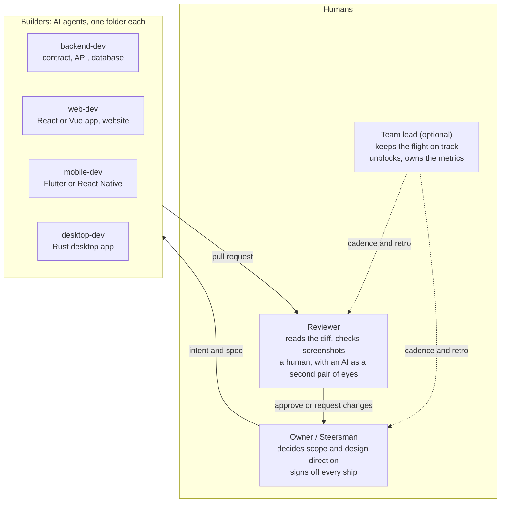
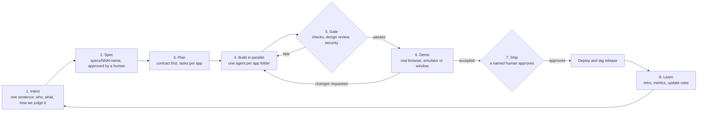
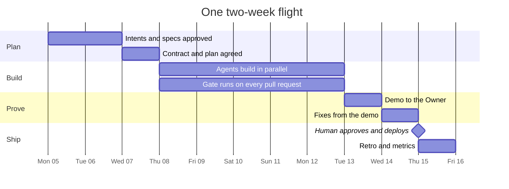
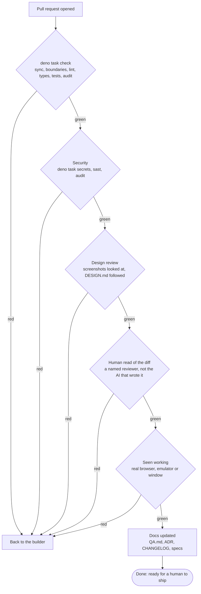

# The Daedalus Method

An agile way of working for teams where AI agents write much of the code and people stay responsible for the result. It
is not a new framework to learn: it names what this repository already does (spec first, contract first, one agent per
app folder, review gates, a human who signs off) and puts it in a cycle you can run alone or with a team. Read time:
about 15 minutes.

The short version: **a human decides, agents build in parallel, gates prove it, a human ships, everyone learns.**

## 1. Roles

| Role | Who | Does |
|---|---|---|
| **Owner** (the Steersman) | A human | Decides what and why, approves specs, accepts the demo, signs off every ship. Final say on scope and design direction. |
| **Builders** | AI agents, one per app folder (`backend-dev`, `web-dev`, `mobile-dev`, `desktop-dev`) | Plan, write code and tests, regenerate clients, run `deno task check`, say what they did not verify. |
| **Reviewer** | A human; an AI pass is an extra, never the gate | Reads the diff, looks at the screenshots, checks the gates. Must understand the area (auth, money, personal data need someone who knows it). |
| **Team lead** (optional) | A human | Keeps the flight on track, unblocks, runs the retro, watches the metrics. Solo developers skip this role. |

One person can hold several roles, with one rule: **the author and the reviewer of a change are different parties**, and
an AI is never the Owner. `AGENTS.md` and `docs/RESPONSIBLE-AI.md` make the same point for agents.

## 2. The cycle

Eight steps. Humans decide at the diamonds.

1. **Intent.** One sentence: who is it for, what changes for them, how will we know it worked. "Signed-in users can search
   their notes by title; success is finding a note in under 3 seconds." If you cannot write it, you are not ready.
2. **Spec.** For anything non-trivial: `deno task spec:new <slug>` creates `specs/NNN-slug/spec.md` and `acceptance.md`.
   The agent drafts, the Owner edits and sets `Status: approved`. A reviewed spec is the cheapest place to catch a wrong
   idea. Anything touching money, auth, personal data or the contract needs one; a typo fix does not.
3. **Plan.** `deno task spec:plan` then `spec:tasks`. Contract first: edit `contracts/openapi.yaml` and run
   `deno task sync` before anything else, so every app sees the same API. The plan lists which app folders change.
4. **Build in parallel.** Each agent owns one folder (backend, web, mobile), so they cannot collide. Separate features
   run in separate git worktrees. Agents work task by task from the spec.
5. **Gate.** See the Definition of Done below. Red goes back to the builder, no exceptions.
6. **Demo.** The Owner sees the change working in a real browser, emulator or desktop window, not a description of it.
7. **Ship.** A named human approves, then someone deploys. Agents prepare the release but never ship unattended
   (`RESPONSIBLE-AI.md`, section 3).
8. **Learn.** A short retro and the numbers (section 6). What went wrong becomes a rule in `AGENTS.md`, a test, a gate
   or an ADR, so it cannot happen the same way twice.

## 3. Cadence

Pick the smallest cadence that fits. The cycle is the same.

| Cadence | For | Shape |
|---|---|---|
| **Daily loop** | Solo developer or tiny team | Morning: pick one intent, write or approve its spec. Day: agents build, you review in small diffs. Evening: demo to yourself, ship if green, note one lesson in `docs/REPORT.md`. |
| **Flight** (1 to 2 weeks) | A team | Day 1 to 2: intents and specs approved, plan agreed. Middle: parallel build with the gate on every pull request. Last 2 days: demo, fixes, ship, retro. |
| **Continuous** (Kanban) | Support-heavy or ops work | Pull the next intent when capacity frees up; limit work in progress to what reviewers can read in a day. |

Size the flight by what reviewers can read, not by what agents can type. Review time is the real capacity.

## 4. Artifacts and where they live

| Artifact | Where | Who writes | Purpose |
|---|---|---|---|
| Specs | `specs/NNN-slug/` (`spec.md`, `acceptance.md`, `plan.md`, `tasks.md`) | Agent drafts, Owner approves | What and why, before code |
| Plan and milestones | `PLAN.md` | Owner and agents | The single source of progress; agents work the first unchecked milestone |
| Contract | `contracts/openapi.yaml` | Agents, reviewed | The API every app and the backend share |
| Design | `DESIGN.md`, `design/tokens.json` | Owner decides, agents apply | The look; no hard-coded colours or spacing |
| Stakeholder report | `docs/REPORT.md` | Agent drafts, Owner edits | Plain-language update after each milestone, flight or incident |
| Bug log | `docs/QA.md` | Anyone | Bugs as a user would see them, with impact |
| Decisions | `docs/adr/` (copy `0000-template.md`) | The person deciding | Why we chose something that changes a rule |
| Change history | `CHANGELOG.md` | Agent drafts, reviewer checks | What shipped, per release |
| Agent rules | `AGENTS.md`, `CLAUDE.md`, `GEMINI.md` | Everyone | Fix the instructions, not the chat |

If an agent needs to know something and it is not in one of these files, add it there. Chat is not memory.

## 5. Definition of Ready and Definition of Done

**Ready** (an intent may enter a build):

- [ ] The intent sentence names the user, the change and how success is observed.
- [ ] A spec exists and is `Status: approved` (or the change is small enough not to need one, and says so).
- [ ] Acceptance criteria are checkable: a command, a screen state, a number.
- [ ] Contract and token changes are identified; unknowns are listed, not guessed.
- [ ] Which app folders change, and who reviews, are named.

**Done** (a change may be shipped by a human):

- [ ] `deno task check` is green: sync, boundaries, lint, types, tests, build, `deno audit`.
- [ ] Security gates pass: `deno task secrets`, `deno task sast`, `deno task audit`.
- [ ] Tests assert behaviour, including failure cases, and would fail if the feature broke.
- [ ] The UI was **looked at** (screenshots at narrow and wide widths, light and dark) and follows `DESIGN.md`; every
      screen has loading, empty and error states.
- [ ] A named human, who is not the AI that wrote it, read the diff, including generated and lock files.
- [ ] Docs match: `docs/QA.md` for bugs found, an ADR for rule changes, `CHANGELOG.md`, the spec marked done.
- [ ] A named human signed off (PR owner field) and, for deploys, approved the release.

## 6. Estimates and velocity with AI

Story points and "lines of code per week" stop meaning much when an agent can produce a thousand lines before lunch.
What does not get faster is deciding, reviewing and verifying. So:

- **Estimate in outcomes, not effort.** Plan how many intents (small, specified, checkable) fit in a flight, sized by
  review load: one reviewer can read roughly 15 minutes of diff per concern. A change that needs more is split.
- **Measure the system, not people.** Track the four DORA numbers monthly (`DELIVERY-METRICS.md`): lead time for changes,
  deployment frequency, change failure rate, time to restore. Count AI-assisted pull requests separately.
- **The warning sign.** If lead time falls while change failure rate or time to restore rises, slow down: smaller diffs,
  more review, more tests. Speed that ships bugs is not speed.
- **Never** use lines written, commits or tokens as a measure of progress or of a person.
- **Velocity** is simply intents shipped per flight that stayed shipped (no rollback, no hotfix). Use it to forecast the
  next flight, not to compare teams.

## 7. If you already use Scrum or Kanban

You do not have to change your ceremonies. Map them:

| Scrum or Kanban | In the Method |
|---|---|
| Product Owner | Owner (Steersman), with the same authority over scope and acceptance |
| Developers | Builders (agents) plus the humans who direct them; the humans own the result |
| Scrum Master | Team lead |
| Product backlog item, user story | Intent, with a spec when non-trivial |
| Refinement | Spec and acceptance criteria written and approved (Definition of Ready) |
| Sprint | Flight (1 to 2 weeks) |
| Sprint planning | Intents and specs approved, contract and plan agreed |
| Daily scrum | A short look at the gate: what is red, what is waiting for a reviewer |
| Sprint review | Demo to the Owner on the running app |
| Retrospective | Learn: lessons become rules, tests or ADRs |
| Definition of Done | The list in section 5 |
| Kanban board, WIP limit | Columns Intent, Spec, Build, Gate, Demo, Shipped; limit WIP to what reviewers can read |

## 8. Anti-patterns

- **Vibe-coding without a spec.** "Build me a notes app" and accept whatever comes back. Fix: intent, spec, acceptance.
- **Unattended deploys.** An agent that ships, migrates data or spends money alone. Fix: agents prepare, humans run the
  command. The guard hooks in the ai-kit pack stop common cases, but they are a safety net, not a permission system.
- **Skipping review because the tests pass.** Tests written by the same AI can check the wrong thing. A person reads the
  diff and looks at the running app.
- **One giant diff.** Nobody can review it, so nobody does. One concern per pull request.
- **Chat as memory.** The same correction every session. Fix the rule file, the brief or the test.
- **Editing generated files.** Change the contract or the tokens, then `deno task sync`.
- **Gate shopping.** Disabling a check, adding an audit ignore without a reason, or merging on red "just this once".
- **The AI as the only reviewer.** A second AI pass helps; it never replaces the named human.
- **Measuring volume.** Lines, commits and "AI wrote 80 percent" say nothing about value or quality.

## 9. Start tomorrow

1. Put one sentence under "Product" in `PLAN.md` and fill `DESIGN.md`.
2. Write the first intent. `deno task spec:new my-first-change`, fill it with your agent, approve it.
3. Let the agent build; run `deno task check`; look at the screen.
4. Read the diff yourself, ship if green, add three lines to `docs/REPORT.md`.
5. After a week, look at the four numbers and change one rule.

Related: [AI-WORKFLOW.md](AI-WORKFLOW.md) (how to brief an agent), [RESPONSIBLE-AI.md](RESPONSIBLE-AI.md) (what AI must
never do alone), [AI-KIT.md](AI-KIT.md) (spec commands, guard, checks), [ROLE-PLAYBOOKS.md](ROLE-PLAYBOOKS.md),
[DELIVERY-METRICS.md](DELIVERY-METRICS.md).
