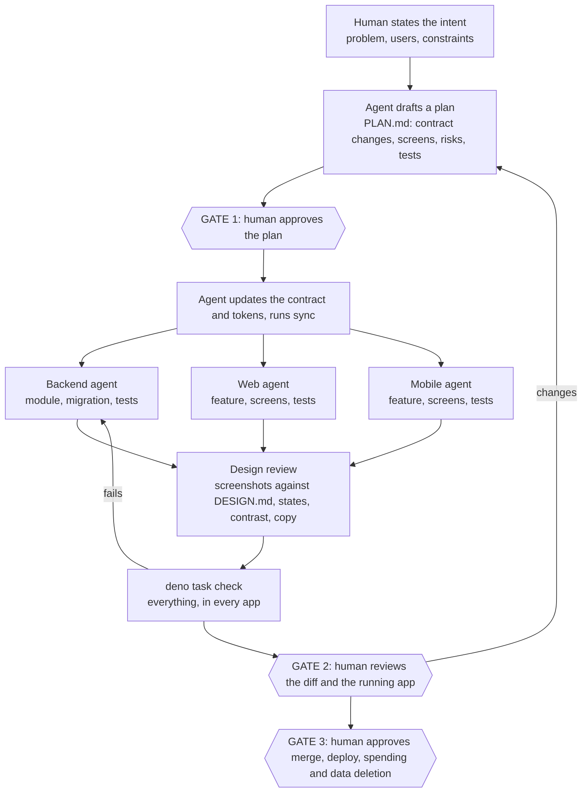

# AI-assisted workflow

Agents do the typing; people keep the decisions. The gates (marked) need a person.

Parallel agents each own separate folders (one app or one module) so they do not collide. Details, briefs and a
checklist against low-quality output: [../AI-WORKFLOW.md](../AI-WORKFLOW.md).
