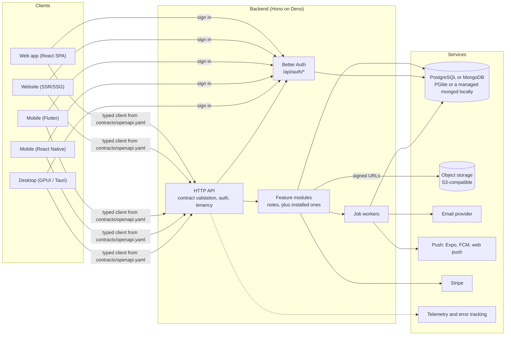

# System architecture

One contract feeds every client, so adding a client never changes the backend. Bytes of files go straight between
clients and object storage; the API only hands out signed URLs. Jobs, mail, push, payments and telemetry appear when
their module is installed ([../MODULES.md](../MODULES.md)).
