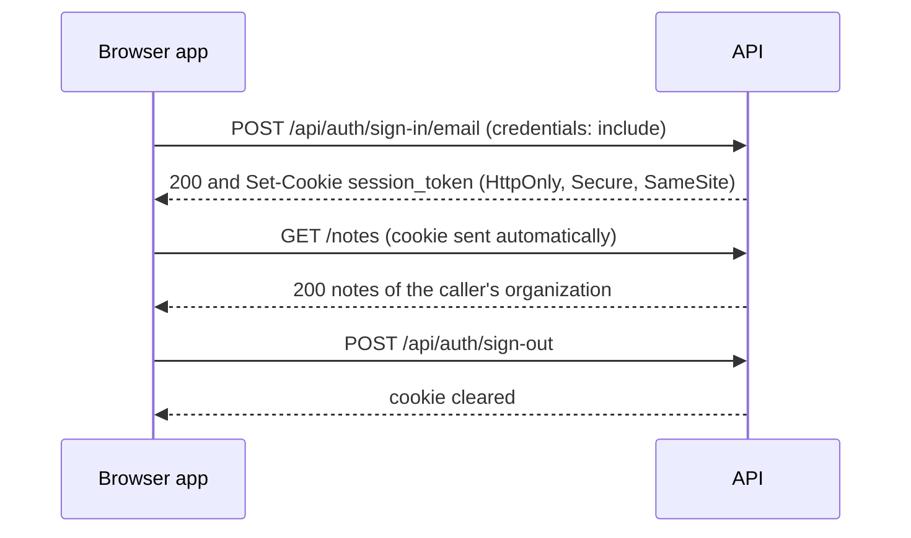
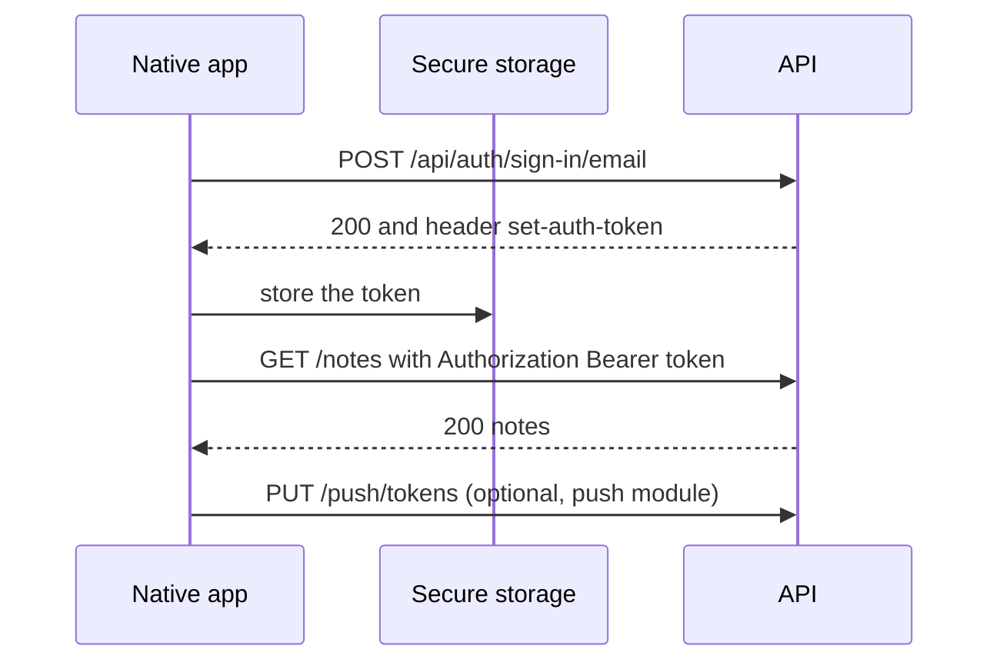
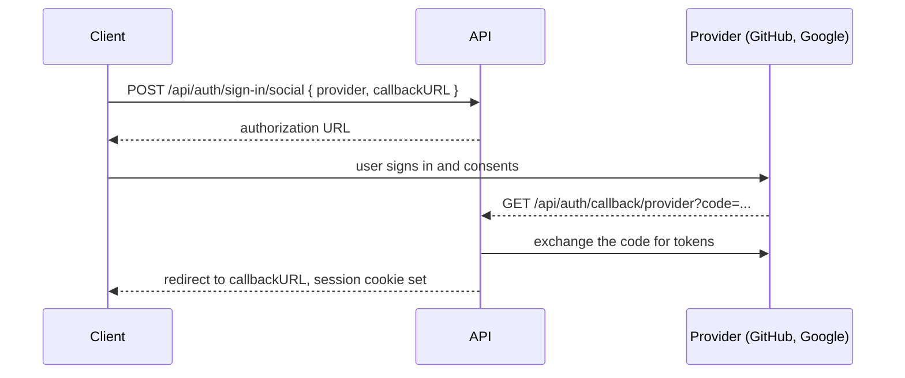

# Auth flows

Accounts are Better Auth under `/api/auth/*`. The same endpoints serve every client; only how the session is carried
differs.

## Web: session cookie

Same-site hosting (app and API under one parent domain) keeps cookies first-party; otherwise list the app's origin in
`AUTH_TRUSTED_ORIGINS`.

## Mobile and desktop: bearer token

Tokens live in the platform's secure storage (Keychain, Keystore), never in plain preferences or logs.

## OAuth (auth-extras module)

Native apps run the same exchange in an in-app browser and return to the app through its URL scheme; the session then
continues as a bearer token. A new user gets a personal organization on first sign-in, whichever method they used.
