# Database diagram

Generated from the Drizzle schema by `deno task diagrams`. Do not edit by hand; change the schema and run the task.
A solid crow's foot is a required reference, a circle an optional one. Conventions are in [../DATABASE.md](../DATABASE.md).

```mermaid
erDiagram
  organization ||--o{ audit_log : "organization_id"
  organization ||--o{ notifications : "organization_id"
  organization ||--|{ files : "organization_id"
  organization ||--|{ invitation : "organization_id"
  organization ||--|{ member : "organization_id"
  organization ||--|{ notes : "organization_id"
  user ||--o{ audit_log : "actor_id"
  user ||--o{ files : "owner_id"
  user ||--o{ notes : "author_id"
  user ||--|{ account : "user_id"
  user ||--|{ idempotency_keys : "user_id"
  user ||--|{ invitation : "inviter_id"
  user ||--|{ member : "user_id"
  user ||--|{ notifications : "user_id"
  user ||--|{ session : "user_id"
  account {
    text id PK
    text account_id
    text provider_id
    text user_id FK
    text access_token
    text refresh_token
    text id_token
    timestamp access_token_expires_at
    timestamp refresh_token_expires_at
    text scope
    text password
    timestamp created_at
    timestamp updated_at
  }
  audit_log {
    uuid id PK
    text organization_id FK
    text actor_id FK
    text action
    text entity_type
    text entity_id
    text request_id
    jsonb metadata
    timestamp_with_time_zone created_at
  }
  files {
    uuid id PK
    text organization_id FK
    text owner_id FK
    text key
    text filename
    text content_type
    bigint size_bytes
    file_status status
    timestamp_with_time_zone created_at
    timestamp_with_time_zone deleted_at
  }
  idempotency_keys {
    text user_id FK
    text key
    text request_hash
    integer status
    text body
    timestamp_with_time_zone created_at
  }
  invitation {
    text id PK
    text organization_id FK
    text email
    text role
    text status
    timestamp expires_at
    timestamp created_at
    text inviter_id FK
  }
  member {
    text id PK
    text organization_id FK
    text user_id FK
    text role
    timestamp created_at
  }
  notes {
    uuid id PK
    text organization_id FK
    text author_id FK
    text text
    timestamp_with_time_zone created_at
    timestamp_with_time_zone updated_at
    timestamp_with_time_zone deleted_at
  }
  notifications {
    uuid id PK
    text user_id FK
    text organization_id FK
    text kind
    text title
    text body
    jsonb data
    timestamp_with_time_zone read_at
    timestamp_with_time_zone created_at
  }
  organization {
    text id PK
    text name
    text slug UK
    text logo
    timestamp created_at
    text metadata
  }
  session {
    text id PK
    timestamp expires_at
    text token UK
    timestamp created_at
    timestamp updated_at
    text ip_address
    text user_agent
    text user_id FK
    text active_organization_id
  }
  user {
    text id PK
    text name
    text email UK
    boolean email_verified
    text image
    timestamp created_at
    timestamp updated_at
  }
  verification {
    text id PK
    text identifier
    text value
    timestamp expires_at
    timestamp created_at
    timestamp updated_at
  }
```

