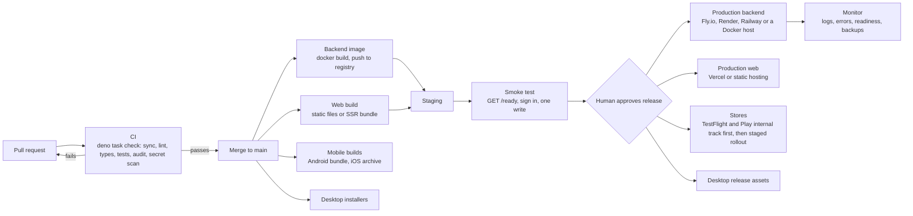

# Deployment pipeline

Migrations run when the first new backend instance starts, so deploy the backend before the clients that need new fields
and follow the zero-downtime rules in [../DATABASE.md](../DATABASE.md). Targets, secrets and the incident checklist:
[../OPERATIONS.md](../OPERATIONS.md).
