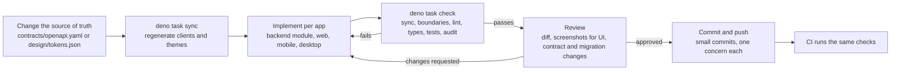

# Daily development loop

Rules that keep the loop short: never edit generated files (change the source and sync); every screen has loading,
empty and error states; every feature ships tests; a schema change ships with its migration and a refreshed ERD.
