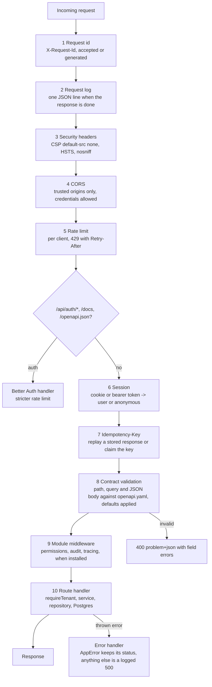

# Request lifecycle

The order of middleware in `backend/src/app.ts`. Any step can end the request with an RFC 9457 problem response; the
error handler turns anything thrown into `application/problem+json` carrying the request id.

Handlers never parse input or check types: by step 10 the body and query already match the contract.
